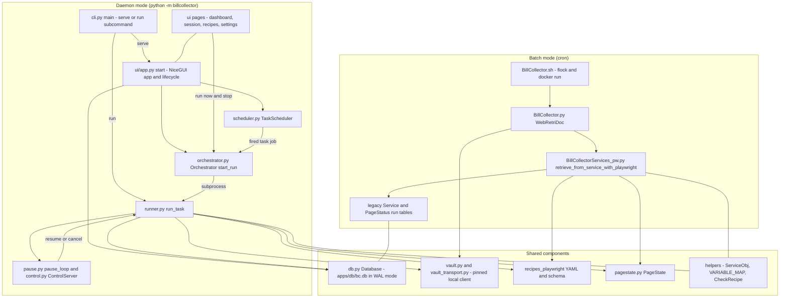
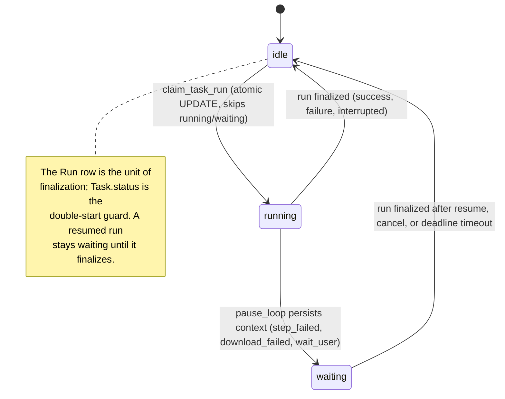

# Architecture Overview: Batch Engine and Daemon

BillCollector has two operating modes that coexist in one repository and one SQLite file:

1. **Batch mode** - a cron-launched, one-shot headless run: `BillCollector.sh` -> `apps/BillCollector.py` -> `apps/BillCollectorServices_pw.py`.
2. **Daemon mode** - a long-running NiceGUI server plus isolated runner subprocesses: `python3 -m billcollector serve` (UI, scheduler, orchestrator) and `python3 -m billcollector run <task_id>` (one task run).

The modes share the data layer (`billcollector/db.py`, `apps/db/bc.db`), the vault client (`billcollector/vault.py`, `apps/vault_transport.py`), the recipe files (`apps/recipes_playwright/`), the `PageState` scan (`billcollector/pagestate.py`), and `helpers/BillCollectorHelpers.py`.

## Diagram

*Caption: both entry modes and the components they share - the batch path writes legacy tables, the daemon path writes the Task/Run schema, both into the same `bc.db`.*

## Batch engine (cron)

- `BillCollector.sh` is the cron wrapper: it takes an exclusive non-blocking `flock` on `apps/.bc.lock` for the whole `docker run` (rejecting a double start), requires a readable `apps/.env`, mounts `.env`, `Downloads`, and `db` into the `billcollector:latest` image, and runs `python3 ./BillCollector.py <ini> [debug]`.
- `WebRetriDoc` in `apps/BillCollector.py` is the batch entry point. It vets the vault with `pinned_api_url`, requires `bitwarden_api_check_status` to report `unlocked`, and posts a `/sync`; any of these failing exits `1` immediately. It then loops the `[Playwright]` sections of the INI file (optionally filtered with `--service <NAME>`), fetches each `<service> <user>` item from the vault, and calls `retrieve_from_service_with_playwright`. A failed service/user pair sets `failed` and `continue`s - per-pair failure isolation - and the process exits `1` at the end if any pair failed, `0` otherwise. The second positional argument is a valued debug switch (`True`/`1`/... turns headed debug on).
- `retrieve_from_service_with_playwright` in `apps/BillCollectorServices_pw.py` returns `True` only when the run completed without aborting **and** at least one file downloaded successfully. `perform_actions` runs a `sync_playwright` persistent Chromium context (`headless=not bcs.dbg`), iterates the recipe's services and steps (sorted by `step`), and records every step as a `PageState` row. A non-graceful step failure raises `StepAbortError` (abort); a `graceful: true` step records the error and continues. `expect_download` steps run their nested steps inside `page.expect_download()`.
- `DatabaseManager` (same file) keeps the legacy schema: a `Service` registry table plus one `PageStatus_<service>_RunN` table per run, created in the same `apps/db/bc.db` file the daemon uses. A `finally` block calls `finalize_service_run` for every started service run, so the DB always holds a terminal `success`/`failure` result even on abort.
- Concurrency guard: besides the wrapper's `flock`, `acquire_run_lock()` in the helpers takes a `LOCK_EX | LOCK_NB` `flock` on the same lock file from inside the process.

## Daemon (`python -m billcollector`)

- `cli.py` `main()` exposes two subcommands: `serve` (bind host from `BC_UI_HOST`, default `127.0.0.1`, port 8000) and `run <task_id> [--debug]`. `serve` first runs `database.import_ini(config.INI_FILES)` (one-time import of the INI `[Playwright]` sections into Tasks, only while the Task table is empty; imported tasks start disabled with a monthly cron), seeds the UI password hash, then `ui_app.start()`. `run` delegates to `runner.run_task` and returns its exit code.
- `ui/app.py` `start()` builds the wiring: `Database`, `Orchestrator(db)`, and `TaskScheduler(db, orchestrator.start_run)`. Startup runs `orchestrator.cleanup_orphans()` then `scheduler.start()`; shutdown stops the scheduler **first** (no new job can dispatch) and then `orchestrator.shutdown()`. `ui.run(..., show=False)` keeps the daemon headless; NiceGUI/Playwright are lazy-imported so `serve` and `run` each load only what they need.
- `scheduler.py` `TaskScheduler` mirrors the Task table into an APScheduler `AsyncIOScheduler` with a SQLAlchemy jobstore in the **same** `bc.db` file - the jobstore is a cache and the Task table always wins. One cron job per enabled task (job id `task-<id>`, target `_task_job` which awaits `start_run`); `resync()` rebuilds all jobs at startup, `sync_task()` handles single-task CRUD. Job defaults: coalesced fires, `max_instances=1`, no misfire grace.
- `orchestrator.py` `Orchestrator.start_run` is the single run entry for scheduler jobs, the dashboard **Run now**, and the recipe editor: it claims the task with the atomic `claim_task_run` (a task already `running`/`waiting` is skipped), acquires the global `max_concurrency` semaphore (default 1), spawns the runner as `python -m billcollector run <task_id>` in its own session (`start_new_session=True`, so the runner leads a process group that takes down its display-stack children), and hands off to `_monitor` - a separate asyncio task that streams the runner's stdout to the per-run log file and to the UI's live-log subscribers, and finalizes the Run row on exit. The runner finalizes its own row with the authoritative result; the orchestrator only closes rows the runner left open (exit `0` -> `success`, negative -> `interrupted`, other -> `failure`, traceback tail appended to `Run.notes`).
- Lifecycle edges in the same module: `cleanup_orphans()` (startup) marks leftover active runs whose pid is dead as `interrupted`, frees their stale display lock, and releases the task to `idle`; `shutdown()` SIGTERMs each live runner's process group (SIGKILL after the 5 s `SHUTDOWN_TIMEOUT`), marks rows the runner left open as `interrupted`, and releases the tasks; `stop_run()` (UI **Stop**) only signals - SIGTERM to one task's runner group, SIGKILL after the 10 s `STOP_TIMEOUT` - and leaves finalization to the runner's signal handler or the monitor, so a graceful result is never overwritten.
- `runner.py` `run_task(task_id, debug)` is the isolated executor: it loads the Task, validates the recipe, allocates an Xvfb display via `display.allocate_display` (atomic lockfile registry) and starts the runner-owned Xvfb/x11vnc/websockify stack, creates the `Run` row recording its own pid, runs `_vault_preflight` (same pinned-local semantics as the batch entry), then `_run_recipe` in a headful persistent **per-task** browser profile. Steps re-execute up to `MAX_STEP_ATTEMPTS = 3` (graceful steps are single-attempt); each step records one `PageStatus` row plus a screenshot. Downloads go through `downloads.track_download` (sha256, per-task dedup, `CONSUMERS` hook slot). Teardown always stops the display stack, finalizes the Run row, and returns the task to `idle`. Exit code: `0` on `success`, `1` otherwise. SIGTERM/SIGINT are converted to a `RunInterrupted` raised in the main thread, so a daemon shutdown or Ctrl+C takes the full teardown (display reap, row finalization as `interrupted`, task release) instead of killing the process in place.
<!-- openwiki: broken internal link [../workflows/pause-repair.md] file "../workflows/pause-repair.md" does not exist. Fix the href or restore the target, then delete this comment. -->
- Stuck runs pause instead of aborting: `_execute_step_with_pause`, `_handle_download_with_pause`, and `wait_user` steps call `pause_loop`, which persists a machine-readable pause context on the Run row, flips the task to `waiting`, pushes an ntfy deep link, and serves the versioned control socket (`control.py`, `PROTOCOL_VERSION = 1`) from the runner's main thread until `resume` (re-execute), `cancel` (`result=cancelled`), or deadline timeout (`result=needs_attention`). See [Run Lifecycle](../workflows/run-lifecycle.md), [Pause, Intervention & Recipe Repair](../workflows/pause-repair.md), and [Shared Interfaces](shared-interfaces.md) for the protocol and state-machine contracts.
<!-- openwiki: broken internal link [../ui/web-ui.md] file "../ui/web-ui.md" does not exist. Fix the href or restore the target, then delete this comment. -->
- The UI pages (dashboard, task detail, session, recipe editor, downloads, settings, auth, runfiles) are registered in `build_app`; all run actions call `orchestrator.start_run` / `stop_run` - the same callbacks the scheduler uses. See [Web UI Pages](../ui/web-ui.md).

## Shared components

- **Database** (`billcollector/db.py`): `SCHEMA` defines `Task`, `Run`, `PageStatus`, `Download`, `Settings` in `apps/db/bc.db` (path overridable via `BC_*` env vars in `config.py`), opened with WAL, `busy_timeout=30000`, and `check_same_thread=False`. Writers are split by table - orchestrator owns Task/Run lifecycle, runner owns PageStatus/Download, UI owns Task CRUD and Settings. The legacy batch tables coexist in the same file untouched (they are runtime status, not an archive). `claim_task_run` is the atomic row lock that makes Task status the double-start guard.
- **Vault client** (`billcollector/vault.py` + `apps/vault_transport.py`): the single client used by both the batch entry point and `runner._vault_preflight`; explicit timeouts, 3 attempts with linear backoff, 4xx raised as `VaultAPIError` (never `sys.exit`), and `pinned_api_url` vetting that the `BW_API_URL` resolves only to local HTTP addresses. See [Vault Transport](../concepts/vault-transport.md).
- **Recipes**: git-versioned YAML at `recipe-pw__<service>.yaml` (lowercase, spaces as underscores, `config.recipe_path_for`). Batch and runner validate with `helpers.CheckRecipe` against `recipe-pw-schema.yaml`; the UI editor validates in-process with `recipes.validate_recipe` and saves atomically. See [Recipe System](../concepts/recipes.md).
- **PageState** (`billcollector/pagestate.py`): the interactive-element scan (with bounding boxes) extracted from `BillCollectorServices_pw.py` and shared by both step loops; Playwright-free so the lightweight runner bootstrap can import it.
- **Helpers** (`apps/helpers/BillCollectorHelpers.py`): `ServiceObj`, `VARIABLE_MAP` (`{{USERNAME}}`/`{{PASSWORD}}`/`{{OTP}}`), `CheckRecipe`, `setup_logging`, `acquire_run_lock`, and the path constants for both modes.

## Invariants and failure semantics

- **Task status machine**: `idle` -> `running` only through the atomic `claim_task_run` (skips `running`/`waiting`); a pause flips to `waiting` so the scheduler cannot re-trigger; every finished or interrupted run returns the task to `idle`.

*Caption: Task.status transitions - only `claim_task_run` moves a task into `running`, and every terminal Run result returns the task to `idle`.*
- **Run result terminal values**: `success`, `failure`, `interrupted`, `cancelled`, `needs_attention`; the runner's own finalization wins, the orchestrator only closes rows the runner left open.
- **Process isolation**: the `serve` process never imports scraping code; a runner crash cannot take down the UI or scheduler, and a SIGKILLed daemon orphans (rather than kills) live runners - startup `cleanup_orphans` then takes over.
- **Batch exit codes**: `0` only when every pair succeeded; vault-preflight failures exit `1` immediately, per-pair failures exit `1` at the end. Runner exit codes: `0` success, `1` anything else.
- **Shared success contract**: both modes define a successful run identically - it completed without aborting **and** at least one file was downloaded, with every downloaded file reporting `success`. The batch entry point returns `True`/`False` on this contract and the runner maps it to `Run.result = success` (via `run_result`), so a "completed" run with no clean download is a failure in either mode.

## Verification

- `BillCollector.sh bc_default.ini` - one cron-style batch run; exit `0` with all downloads recorded in the legacy tables.
- `python3 BillCollector.py bc_test.ini debug` - headed debug batch run over the test INI (see README "Local Development & Debugging").
- `python3 -m billcollector serve` - starts the daemon on port 8000; first start shows the set-password form, the dashboard then lists the INI-imported tasks.
- `python3 -m billcollector run <task_id>` - one standalone runner execution (display, vault, and recipe preflight included).
