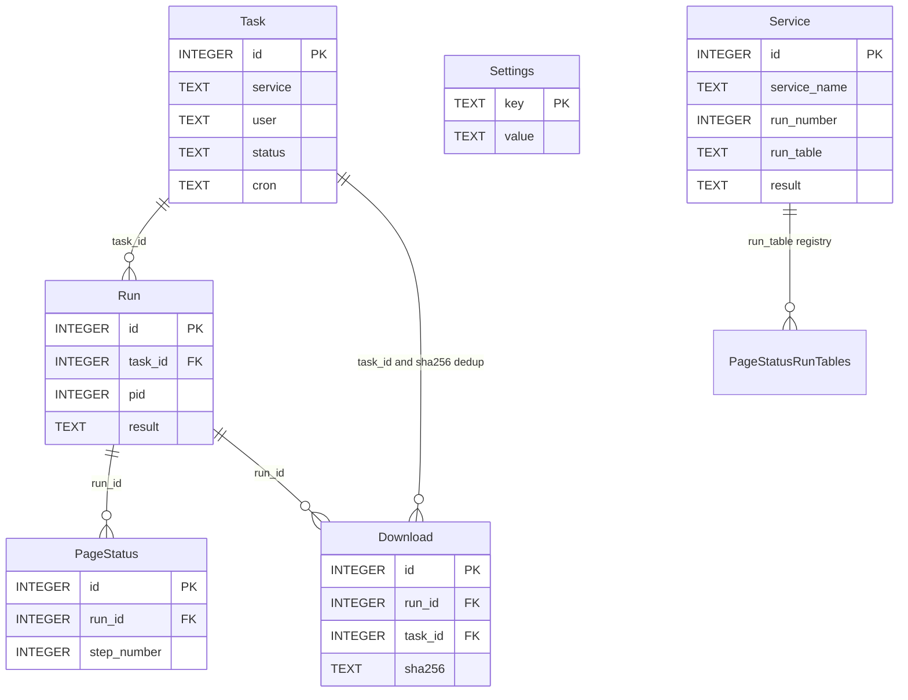
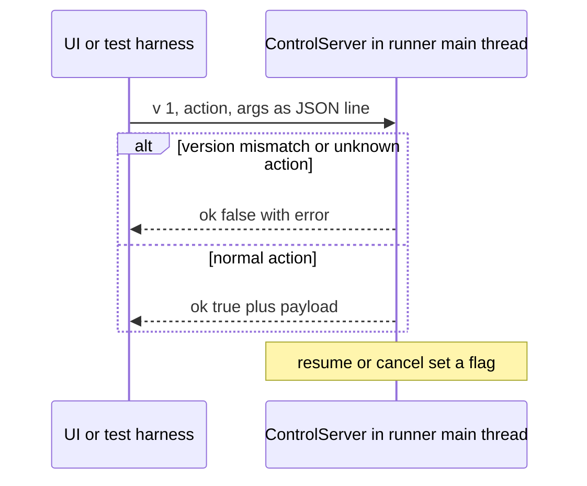

# Shared Interfaces (Contracts)

[CONTRIBUTING.md](../../CONTRIBUTING.md) names four **shared interfaces**: the database schema, the control protocol, the recipe contract, and the exit codes. A change to any of them is agreed in an issue before code, and the PR that touches one references that issue. This page documents each contract: its shape, its invariants, and the code that enforces it. Both operating modes depend on these interfaces - the batch engine (`apps/BillCollector.py`) and the daemon (`apps/billcollector/`) - so a silent change on either side breaks the other. See [Architecture Overview](overview.md) for the two modes.

## 1. SQLite schema

### Shape

`SCHEMA` in `apps/billcollector/db.py` creates five tables in `apps/db/bc.db` (path overridable via `BC_*` env vars in `billcollector/config.py`):

- **Task** - `id`, `service`, `user`, `recipe_file`, `enabled`, `cron`, `last_run`, `next_run`, `status` (default `'idle'`), `profile_dir`, `profile_reset_at`, `created_at`, `updated_at`; `UNIQUE (service, user)`
- **Run** - `id`, `task_id`, `pid`, `display`, `novnc_port`, `log_path`, `control_sock`, `started_at`, `ended_at`, `result`, `pause_reason`, `pause_prompt`, `pause_context`, `pause_deadline_at`, `notes`
- **PageStatus** - `id`, `run_id`, `step_number`, `locator_action`, `interactive_elements`, `screenshot_path`, `error`
- **Download** - `id`, `run_id`, `task_id`, `url`, `filename`, `size`, `sha256`, `saved_path`, `created_at`, `duplicate_of_id`
- **Settings** - `key` (primary key), `value`


*Caption: the daemon data model (Task/Run/PageStatus/Download/Settings) beside the legacy batch registry (`Service` points at its dynamic `PageStatus_<service>_RunN` tables). All of it lives in the same `bc.db` file.*

The legacy batch schema lives in the **same file**: `DatabaseManager` in `apps/BillCollectorServices_pw.py` creates a `Service` registry table (`id`, `service_name`, `run_number`, `run_table`, `timestamp_start`, `timestamp_end`, `download_info`, `result`) plus one `PageStatus_<service>_RunN` table per run (`id`, `service_name`, `step_number`, `locator_action`, `interactive_elements`, `result`). The daemon never touches them; they hold runtime status, not an archive.

### Invariants

- **The Task table is the source of truth for scheduling.** The APScheduler jobstore in `billcollector/scheduler.py` is a cache in the same `bc.db` file; `resync()` rebuilds it from Task at startup and the Task table always wins.
- **`UNIQUE (service, user)`** on Task: one task row per service/user pair (the batch INI's item naming).
- **`Run.result` starts NULL** (active) and always ends with a terminal value: `success`, `failure`, `interrupted`, `cancelled`, `needs_attention`. `list_active_runs()` is defined as `result IS NULL`; a pause is recognized as `result IS NULL AND pause_reason IS NOT NULL`.
- **Task status machine**: `idle` -> `running` only via the atomic `claim_task_run` (a conditional `UPDATE ... WHERE status NOT IN ('running','waiting')` row lock); a pause flips the task to `waiting`; every finished or interrupted run returns it to `idle`.
- **Writers are split by table**: the orchestrator owns Task/Run lifecycle, the runner owns PageStatus/Download, the UI owns Task CRUD and Settings. The connection uses WAL mode, `busy_timeout=30000`, and `check_same_thread=False`; safety comes from the split plus short writes only.
- **Migrations are additive and idempotent**: `_init_schema` runs `SCHEMA` (`CREATE TABLE IF NOT EXISTS` only) then `_migrate`, which adds each new column with a one-time `ALTER TABLE` guarded by a `PRAGMA table_info` check (e.g. `Task.profile_reset_at`). No migration framework.
- **Terminal-result discipline**: the batch path finalizes every started service run in a `finally` block (`finalize_service_run` writes `success`/`failure` into `Service`), and the runner's teardown always writes `result` + `ended_at` before releasing the display.

### Where it is enforced

- `SCHEMA` and `Database._init_schema` / `_migrate` in `apps/billcollector/db.py`.
- `claim_task_run` (db.py) for the row lock; `pause.persist_pause` (pause.py) for the `waiting` flip; the runner teardown in `runner.run_task` for finalization.
- The legacy shape is enforced by `DatabaseManager` (`create_service_run_table`, `finalize_service_run`) in `apps/BillCollectorServices_pw.py`.

## 2. Daemon control protocol

### Shape

`apps/billcollector/control.py` defines a versioned JSON-line protocol over one Unix socket per paused run (`run-<run_id>.sock` under the run directory). `PROTOCOL_VERSION = 1`; the first field of every message is `v`:

```json
{"v": 1, "action": "<name>", "args": {...}}
{"v": 1, "ok": true, ...payload}
{"v": 1, "ok": false, "error": "..."}
```

Actions: `screenshot` (base64 PNG), `elements` (numbered interactive-element scan), `context` (the machine-readable pause payload), `click {n}`, `fill {n, text}`, `press {key}`, `drag {n, dx, dy}` - plus the **reserved** `resume` and `cancel`, which end the pause and are consumed by the runner, not by a handler. Constants: 4 MiB `MAX_MESSAGE_BYTES` per message, 120 s client timeout, 60 s per request line.


*Caption: one request per short-lived connection; the waiting loop observes `resume_requested` / `cancel_requested` on the next poll.*

### Invariants

- **Versioning is the change rule**: protocol changes need a version bump in `control.py` and a doc update. The server rejects a request whose `v` does not equal `PROTOCOL_VERSION` with an `ok: false` error, so a mismatched peer fails closed instead of misbehaving.
- **`resume` and `cancel` are reserved**: passing them as handlers raises `ValueError` at construction; the server sets `resume_requested` / `cancel_requested` flags that the runner's waiting loop (`pause.pause_loop`) polls.
- **Thread confinement**: the server is served by the runner's **main thread** between steps (the waiting loop calls `poll()`), so the synchronous Playwright calls inside the action handlers are safe. `ControlClient` opens a short-lived connection per request.
- **The pause context payload is the AI-integration contract** (built by `pause.build_pause_context`): it must stay complete, stable, and small. A failed action is reported to the client and the pause stays active; a shutdown signal (`RunInterrupted`) always propagates instead of being swallowed.

### Where it is enforced

- `ControlServer._serve_connection` in `apps/billcollector/control.py` (version check, reserved actions, 4 MiB cap, malformed-JSON rejection) and `ControlClient.request` (raises `ControlError` on transport failure or `ok: false`).
- The handler map (`screenshot`, `elements`, `context`, `click`, `fill`, `press`, `drag`) is built in `pause.make_action_handlers`; the waiting loop in `pause.pause_loop` binds the socket, records `Run.control_sock`, and exits on `resume`, `cancel`, or deadline.

## 3. Recipe contract

### Shape

The recipe contract is the pair `apps/recipes_playwright/recipe-pw__<service>.yaml` + `apps/recipes_playwright/recipe-pw-schema.yaml` (a JSON Schema draft-07 document). The schema's shape:

- top-level object, `additionalProperties: false`, with `$schema` (string) and `services` (array)
- each service **requires** `serviceName` and `steps`
- each step **requires** the integer `step`; optional `description`, `graceful` (boolean), `methods` (array), and nested `steps` (array) for the `expect_download` body
- each method **requires** `method` (string); optional `arguments`, an array of flat key/value objects whose values may be strings, booleans, numbers, objects, or null

Files are named `recipe-pw__<service>.yaml` (service lowercased, spaces as underscores) and located by `config.recipe_path_for`.

### Invariants

- **Schema validation gates every consumer.** The batch path (`BillCollectorServices_pw.retrieve_from_service_with_playwright`) and the daemon runner (`runner.run_task`) both call `CheckRecipe` (`helpers/BillCollectorCheckRecipe.py`) with the shared schema file at run start; a missing or invalid recipe aborts that run (batch: the pair fails; runner: exit 1).
- **`graceful` has one meaning**: `true` records a step failure (log + DB) and continues; `false` (default) aborts the run. Both step loops implement this identically.
- **The UI saves only validated recipes**: `recipes.validate_recipe` (in-process, `yaml.safe_load` + `jsonschema.Draft7Validator`, structured error text, never raises) is the write site's gate, and `save_recipe` writes atomically (temp file in the same directory + `os.replace`).

### Where it is enforced

- `recipe-pw-schema.yaml` itself (draft-07, `additionalProperties: false` at the top level).
- `CheckRecipe` in `apps/helpers/BillCollectorCheckRecipe.py` (batch + runner) and `validate_recipe` in `apps/billcollector/recipes.py` (UI editor and repair flow). See [Recipe System](../concepts/recipes.md) for authoring details.

## 4. Process exit codes

### Shape

| Process | Codes |
| --- | --- |
| Batch entry point `apps/BillCollector.py` | `0` all service/user pairs succeeded · `1` any pair failed, or any preflight/usage error |
| Runner `runner.run_task` (`python -m billcollector run <task_id>`) | `0` `Run.result=success` · `1` anything else |
| Regression harness `tests/run_regression.py` | `0` all expectations matched · `1` at least one deviated · `2` mock portal could not start · `3` a real run holds the run lock · `4` `--vault` preflight failed |

### Invariants

- **Batch: per-pair failure isolation.** A failed (or vault-broken) pair sets `failed` and the loop continues; the process exits `1` at the end if any pair failed, `0` otherwise. Vault preflight (pinned local API URL, `unlocked` status, `/sync`), an unreadable INI, and usage errors (bad argument count, missing INI, `--service` without value) exit `1` immediately. The `flock` run lock (`BillCollector.sh` + `acquire_run_lock` in the helpers) refuses a second concurrent start with exit `1`.
- **Runner: two-valued, result-derived.** `run_task` returns `0` exactly when `run_result(...)` yields `success` (no abort, at least one download, all download entries successful) and `1` for task-not-found, invalid recipe, display-allocation failure, vault-preflight failure, any step failure, and an interrupted run. The exit code and `Run.result` agree: the DB row carries the richer terminal value.
- **Orchestrator fallback only.** The orchestrator never overwrites the runner's own finalization; it closes only a row the runner left open (`result IS NULL`), mapping the exit code: `0` -> `success`, negative (signal-killed) -> `interrupted`, other -> `failure`, with the output tail appended to `Run.notes`.
- **Harness codes are diagnostic, not pass/fail.** The harness (`tests/run_regression.py`, driven by `tests/scenarios.py` and `tests/mock_portal/`) distinguishes expectation deviations (1) from environment failures (2-4), so a green run (`0`) proves the engine's return values, DB rows, downloads, and exit semantics all matched. Run it from the repository root: `apps/.venv/bin/python tests/run_regression.py --ini tests/bc_regression.ini`.

### Where it is enforced

- Batch: the `sys.exit(1)` sites in `apps/BillCollector.py` (`WebRetriDoc` preflight, per-pair `failed` flag, argument handling) and the `flock` in `BillCollector.sh`.
- Runner: the return paths of `runner.run_task` (and `run_result` for the terminal `Run.result` mapping - cancel -> `cancelled`, timeout -> `needs_attention`).
- Harness: `tests/run_regression.py` (documented in the README, "Local Regression Test Environment").

## Change rules and cross-references

- Any change to the four interfaces is agreed in an issue first; the PR references it ([CONTRIBUTING.md](../../CONTRIBUTING.md), "Shared interfaces").
- Schema changes are additive (idempotent `_migrate`) - existing `bc.db` files must keep working.
- Control-protocol changes need the `PROTOCOL_VERSION` bump and a doc update in the same change.
- Exit-code changes ripple to cron wrappers, the orchestrator's `_finalize_run` mapping, and the regression harness's expectations, which is why they are shared rather than per-process.

Related pages: [Architecture Overview](overview.md), [Recipe System](../concepts/recipes.md), [Vault Transport](../concepts/vault-transport.md).
