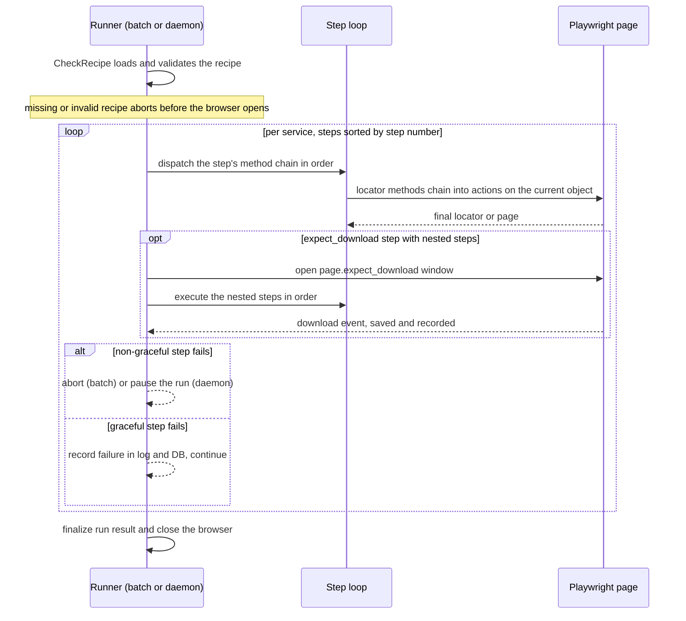

# Recipe System

A **recipe** is a YAML document that describes, step by step, the browser automation one BillCollector run performs against a portal: open the login page, fill the fields, click through, and download the wanted document. One recipe exists per web portal, is shared by every task (user) of that portal, and is the automation counterpart of the task's vault credentials. The recipe is one of the four **shared interfaces** named in [CONTRIBUTING.md](../../CONTRIBUTING.md); a change to the contract is agreed in an issue before code, and the [README's "Web Service Config" section](../../README.md#web-service-config) covers the authoring basics (vault entry, INI list, recipe). The contract's invariants and enforcement points are documented in [Shared Interfaces (Contracts)](../architecture/shared-interfaces.md); this page documents the mechanics.

## Recipe anatomy

A recipe is a top-level object with at most two keys — `$schema` (string, optional) and `services` (array) — defined against the JSON Schema draft-07 document `apps/recipes_playwright/recipe-pw-schema.yaml`. The nesting goes:

- **service** — `serviceName` (required) + optional `description`, and `steps` (required). A typical recipe has exactly one service, whose `serviceName` matches the file name.
- **step** — requires the integer `step` (the execution order key); optional `description`, `graceful` (boolean), `methods` (array), and nested `steps` (array) which carry the `expect_download` body. Steps may nest recursively per the schema.
- **method** — requires `method` (string); optional `arguments`, an array of flat key/value objects. Each method's arguments are written as **one single-key dict per argument** (e.g. `- role: "button"` and `- name: "Log in"`), which the runner merges into keyword arguments.

The real `winsim` recipe (`apps/recipes_playwright/recipe-pw__winsim.yaml`, condensed; the start URL is shown as `<portal-start-url>` — recipes carry only `{{VARIABLE}}` placeholders for anything secret, never credentials) shows the full anatomy in one file:

```yaml
services:
- serviceName: winsim
  steps:
  - step: 1
    methods:
    - method: goto
      arguments:
      - url: "<portal-start-url>"
  - step: 3
    methods:
    - method: locator
      arguments:
      - selector: "#UserLoginType_alias"
    - method: fill
      arguments:
      - value: "{{USERNAME}}"
  - step: 5
    methods:
    - method: get_by_label
      arguments:
      - text: "Servicewelt-Passwort:"
    - method: fill
      arguments:
      - value: "{{PASSWORD}}"
  - step: 10
    methods:
    - method: get_by_text
      arguments:
      - text: "Rechnung vom"
    - method: first
    - method: click
  - step: 11
    methods:
    - method: expect_download
    steps:
    - step: 12
      methods:
      - method: get_by_role
        arguments:
        - role: "link"
        - name: "Rechnung"
        - exact: true
      - method: "click"
  - step: 13
    methods:
    - method: close
```

The shape the schema enforces is visible across these steps: a `goto` step whose only method is a page-level method, a locator method (`locator`, `get_by_label`) chained into a `fill` whose `value` argument is exactly a placeholder, `first` as a chain-continuing method before `click`, the `expect_download` step with its nested `steps` body (step 12 inside step 11), and the terminal `close`. The full recipe (login type switch, dialog confirmations, invoice navigation) follows the same patterns. The local mock-portal test recipes (e.g. `recipe-pw__testhappy.yaml`) demonstrate the same contract plus the daemon-only extensions — `graceful` steps, `press`, `content_frame`, `wait_user` — against `http://127.0.0.1:8787/`. Committed recipes also carry a `$schema` field (a local schema path from the authoring machine); the schema itself lives at `apps/recipes_playwright/recipe-pw-schema.yaml`.

## File naming and lookup

Recipe files live in `apps/recipes_playwright/` and follow the naming convention `recipe-pw__<service>.yaml`: the prefix is `RECIPE_PREFIX = "recipe-pw__"` and the service name is **lowercased with spaces replaced by underscores** (e.g. a portal named `Freenet Mobilfunk` becomes `recipe-pw__freenet_mobilfunk.yaml`). Both consumers derive the path the same way:

- the batch engine (`BillCollectorServices_pw.retrieve_from_service_with_playwright`) builds `RECIPES_PLAYWRIGHT_DIR / f"{RECIPES_PLAYWRIGHT_PREFIX}{sname}.yaml"` from `service.lower().replace(" ", "_")`;
- the daemon runner (`runner.run_task`) uses `task["recipe_file"]` or falls back to `config.recipe_path_for(service)`, which computes `RECIPE_DIR / f"{RECIPE_PREFIX}{service.lower().replace(' ', '_')}.yaml"`.

The UI recipe editor (`/recipes/<service>`) uses the same `config.recipe_path_for` to locate the file it edits, and tasks created by the daemon store the path in `Task.recipe_file` (`billcollector/db.py`).

## Method chains: locators and actions

A step is a **chain of method entries executed in order**. Each method is dispatched with `getattr` on the current Playwright object (starting at the `Page`); a method's non-None result becomes the object the next method runs on, so locator methods and actions interleave freely:

| Role | Methods | Effect |
| --- | --- | --- |
| Locators | `locator` (CSS selector), `get_by_role`, `get_by_label`, `get_by_text`, `get_by_title`, `get_by_placeholder`, `get_by_test_id` | produce a locator the chain continues with |
| Chain-continuing | `first`, `content_frame` | `first` narrows to the first match; `content_frame` enters an iframe and later methods run inside it |
| Element actions | `click`, `fill` (`value`), `press` (`key`) | act on the current locator |
| Page-level | `goto` (`url`), `close` | `goto` opens the start URL on the page; `close` closes it |
| Daemon-only | `wait_user` | a daemon-runner step method that pauses for the operator (see below) — in batch mode it is dispatched as an unknown method and fails the step |
| Special | `expect_download` | must carry nested `steps`; the body executes inside a download expectation (see below) |

Argument handling: when **all** of a method's processed arguments are dicts, they are merged and passed as keyword arguments; otherwise they are passed positionally. That is why the list-of-single-key-dicts shape in the YAML maps cleanly onto Playwright signatures. Each consumer also categorizes the chain for recording: a fixed list of "actions" (`click`, `fill`, `expect_download`, `goto`, `close`, `content_frame`, `first`) versus everything else as "locators" — the batch runner does this in its `process_step`, and the daemon runner has an identical module-level `transform_step_to_json` feeding both the `PageStatus.locator_action` column and the pause context. The method name itself is not constrained by the schema — a misspelled locator method surfaces at run time as a step failure, which is what the pause/repair flow exists to catch.

## Execution flow

Both the batch engine (`perform_actions` in `apps/BillCollectorServices_pw.py`) and the daemon runner (`_run_recipe` in `apps/billcollector/runner.py`) iterate `services` and execute each service's top-level steps **sorted ascending by `step` number**.


*Caption: the recipe step loop as implemented by both consumers; the daemon adds the pause branch for exhausted non-graceful steps, and the batch engine records into its own run tables.*

Every executed step is recorded (batch: one row per step in the `PageStatus_<service>_RunN` table created by `DatabaseManager`; daemon: one `PageStatus` row per step, with a step screenshot). A run **succeeds only if it completes without aborting and at least one file is downloaded with every download entry successful** (`run_result` in the runner, the equivalent check in the batch entry point) — a run that finishes every step but never downloads anything is a failure.

## Graceful steps and failure semantics

`graceful: true` has one meaning on both consumers, and the two step loops implement graceful identically: a failure of that step is **recorded in the log and the database, and the run continues with the next step**; without it (the default), a failure aborts the run. The difference is what a non-graceful failure costs first:

- **Batch engine** (`perform_actions`): no pause and no retry — the failure raises `StepAbortError`, which is recorded against the failing step (its `PageState` is carried on the exception) before the run aborts.
<!-- openwiki: broken internal link [../workflows/pause-repair.md] file "../workflows/pause-repair.md" does not exist. Fix the href or restore the target, then delete this comment. -->
- **Daemon runner** (`_run_recipe`): a non-graceful step re-executes the **full method chain up to `MAX_STEP_ATTEMPTS` (3)** attempts; if it still fails (or the download fails) it does not abort immediately but **pauses the run** (`reason=step_failed` / `download_failed`) so an operator can fix the page or repair the recipe via the UI. Resume re-executes the step from the beginning with a fresh attempt budget, cancel ends the run `cancelled`, and the pause deadline ends it `needs_attention`. The pause/repair mechanics are covered on [Pause, Intervention & Recipe Repair](../workflows/pause-repair.md).

Graceful steps are **single-attempt in both consumers and never pause**: the runner's `step_attempts` returns 1 for a graceful step regardless of `MAX_STEP_ATTEMPTS`, and a graceful failure is logged and recorded exactly like a non-graceful one — it simply does not raise.

The `testgraceful` test recipe demonstrates the pattern twice: its cookie-banner dismissal step is `graceful: true` because the banner is absent when the consent cookie persists, and a later step targets a "Bonus document" link the mock site never renders, so both failures must not stop the happy path or its download.

## expect_download and downloads

A download is expressed as a step whose `methods` list contains a single `expect_download` method and whose **nested `steps`** are the clicks that trigger the download. At run time the nested steps execute inside `page.expect_download()`; the resulting download is saved (batch: into the download directory under its suggested file name) or tracked (daemon: `downloads.track_download` records url, filename, size, sha256, saved path, and per-task dedup). If no download arrives, the outcome follows the step's `graceful` flag exactly like any step failure — continue after recording, or abort (batch) / pause (daemon). In the daemon, a downloaded file is only part of the success contract when its entry result is `success`; the batch path mirrors this in its `Service` table's `download_info` and `result` columns.

## Runtime variables

Three placeholders are substituted at run time from the run's credentials:

- `{{USERNAME}}` — the portal user name,
- `{{PASSWORD}}` — the portal password,
- `{{OTP}}` — the one-time code.

Substitution is exact-string: an argument string that **is** the placeholder is replaced; placeholders embedded in a longer string are left as-is, and in dict arguments only string values that exactly match a placeholder are replaced. In batch mode all three come from the credentials fetched once at run start (`helpers.VARIABLE_MAP`). In the daemon runner, `{{OTP}}` is special: the runner's own variable map re-fetches the item's **current TOTP from the vault at substitution time** (`_fresh_otp`), because a code fetched at run start can be stale by the time the recipe submits it; on fetch failure it falls back to the run-start value.

## wait_user steps (daemon runner)

A daemon-runner step whose method chain contains `wait_user` pauses **before execution** (`reason=wait_user`) and is *consumed* on resume, not re-executed — important for one-shot portal interactions such as entering a displayed CAPTCHA code, since a consumed code cannot be re-entered. Optional method arguments: `prompt` (the operator-facing text; defaults to a generated "Step N: description" prompt) and `until` (a locator dict with one of the keys `role`, `test_id`, `placeholder`, `label`, `text`, `selector`, mapped to the corresponding Playwright locator). With `until`, the step completes only once that locator is visible, bounded by the pause deadline; a missed deadline re-pauses with the same prompt. An unrecognized `until` key is a recipe authoring error and aborts the step. The test recipes `testwaituser` and `testcaptchadrag` exercise this pattern against the mock portal.

## Validation

Two validation paths gate recipes, both against the same schema file:

**Command line** — `helpers/BillCollectorCheckRecipe.py` (function `CheckRecipe`), the CLI used for pre-flight and by humans:

```bash
cd apps
.venv/bin/python helpers/BillCollectorCheckRecipe.py recipes_playwright/recipe-pw__testhappy.yaml
```

Expected outcome: **exit 0** for a valid recipe. The CLI's main quirk: its `__main__` block calls `CheckRecipe` **without checking the return value**, so a **schema violation** is logged as `Validation fault: ...` but still ends with exit 0 — the log line, not the exit code, is the signal (likewise a missing recipe file in the two-argument form, where `Cannot open ...` is logged). Exit 1 is issued for usage and availability errors: a wrong argument count, a schema file that is missing, unreadable, or not valid YAML, and a recipe without a usable `$schema` field — a missing recipe file in the one-argument form fails exactly there, via the `$schema` fallback. A syntactically invalid recipe YAML also exits 1 (an uncaught traceback in the explicit-schema form). The optional second argument `<schema.yaml>` overrides the schema, which otherwise comes from the recipe's `$schema` field — resolved as its **basename inside the recipe's own directory**, which is why committed recipes whose `$schema` points at an authoring machine's home path still validate from the CLI.

The same function is the run-time gate in both consumers, and there the `None` return value is what matters: the batch path (`retrieve_from_service_with_playwright`) calls `CheckRecipe` with the shared schema file before executing and raises when it returns `None` (recipe not found / invalid → the service/user pair fails), and the daemon runner (`run_task`) does the same, returning exit 1 (failed run) when the recipe is missing or invalid.

**UI** — `validate_recipe` in `apps/billcollector/recipes.py`: `yaml.safe_load` plus `jsonschema.Draft7Validator` against `config.RECIPE_SCHEMA`, returning a structured `(ok, error, data)` triple with path-qualified error text and **never raising**. It is the editor's Validate button, the editor's Save gate, and the gate inside `save_recipe` itself.

## Authoring with the codegen helper

`helpers/BillCollectorCreateRecipe_pw.py` builds recipes from Playwright's codegen:

- `-g --url <url> --service <name>` runs `playwright codegen` (Python target) against the URL into `recipes_playwright/.code/<service>.py`, then scans the script for `.fill(...)` calls and interactively prompts replacing sensitive literals with `{{USERNAME}}` / `{{PASSWORD}}` / `{{OTP}}` (keyword-based suggestion from `VARIABLE_LABELS`);
- `-t --service <name>` translates that Python code into the recipe YAML: each `page.*` line becomes a step (chained dot-calls become the method list), `with page.expect_download():` blocks become the nested-step shape, and the output is written to `recipes_playwright/recipe-pw__<service>.yaml` with the `$schema` field set to the schema file's local path.

## The UI editor: atomic save and git auto-commit

The recipe editor page (`/recipes/<service>`, `apps/billcollector/ui/recipes.py`) is where operators maintain recipes. It loads the per-service file (shared by all tasks of the service, which it lists), renders a read-only **step tree** sidebar (flattened by `parse_steps`, re-parsed on every edit — a broken YAML document is shown as a parse error rather than rendered), and offers **Validate** and **Save**:

- **Save = validate → atomic write → optional commit.** Validation failure writes nothing. The write is `save_recipe`: the text is validated again at the write site, then written to a temp file **in the same directory** and moved over the recipe with `os.replace`, so the file is never left half-written.
- **Git auto-commit.** When the `git_commit_enabled` setting is truthy (default `false`), the saved file is committed by `billcollector/gitcommit.git_commit`, which stages **exactly that file** (never `git add -A` — unrelated dirty files must not be swept into the commit) with the message `recipe(<service>): <summary>`, where the summary is the first changed service description, else `edited via UI`. A no-op save (nothing to commit) is a success, not an error.
<!-- openwiki: broken internal link [../workflows/pause-repair.md] file "../workflows/pause-repair.md" does not exist. Fix the href or restore the target, then delete this comment. -->
- **Repair entry point.** Opened with `?run=<run_id>` (the **Repair recipe** link on a paused run's session page), the editor preloads a failure panel from the run's pause context — failure screenshot, failed step, expected locator chain, and candidate elements. **Use** on a candidate replaces the failed step's locator prefix with the candidate's locator (`apply_candidate_to_step` in `billcollector/recipes.py`; the input document is never mutated, and steps without a locator prefix or nested `expect_download` steps are not repair targets), after which the normal Validate → Save → commit flow applies. The full pause/repair mechanics are covered on [Pause, Intervention & Recipe Repair](../workflows/pause-repair.md).
- After a successful save the page shows a **Run now** button per task of the service.

## Verification

```bash
cd apps
# Valid recipe: exits 0, no error output
.venv/bin/python helpers/BillCollectorCheckRecipe.py recipes_playwright/recipe-pw__testhappy.yaml
# A schema-violating recipe: also exits 0 (the CLI ignores the return
# value) - the signal is the logged "Validation fault: ..." line
# Missing recipe file (one-argument form): exits 1 via the $schema fallback
.venv/bin/python helpers/BillCollectorCheckRecipe.py recipes_playwright/recipe-pw__doesnotexist.yaml
# Wrong argument count: exits 1 with usage text
.venv/bin/python helpers/BillCollectorCheckRecipe.py
```

For the UI path, the equivalent check is `billcollector.recipes.validate_recipe(text)` returning `(True, None, data)` for a valid document and `(False, "<path>: <message>", None)` for a schema violation — no process exit involved.

## Pitfalls

- **The recipe file name is load-bearing.** A portal whose vault name changes casing or spacing breaks `recipe_path_for`/the batch lookup silently (recipe "not found") — keep the file name in lockstep with the service name, lowercased, spaces as underscores.
- **No download means failure.** A recipe that completes every step but wraps nothing in `expect_download` (or whose download never fires) ends the run as a failure on both consumers.
- **Method names are runtime-checked, not schema-checked.** The schema only requires `method` to be a string; a typo in a locator method becomes a step failure at run time, which is exactly what the daemon's pause + candidate-repair flow is built to recover.
- **`{{OTP}}` timing.** In daemon runs the OTP placeholder re-fetches the TOTP at substitution time; do not replace it with a literal in a recipe.
- **Committed recipes' `$schema` field** contains a local home path from the authoring machine; new recipes should reference the schema at its repo-relative location `apps/recipes_playwright/recipe-pw-schema.yaml`.

## Related pages

- [Shared Interfaces (Contracts)](../architecture/shared-interfaces.md) — the recipe contract's invariants and enforcement points
- [Architecture Overview](../architecture/overview.md) — the batch engine and daemon runner side by side
- [Run Lifecycle](../workflows/run-lifecycle.md) — what wraps the recipe step loop (vault preflight, display, run row)
<!-- openwiki: broken internal link [../workflows/pause-repair.md] file "../workflows/pause-repair.md" does not exist. Fix the href or restore the target, then delete this comment. -->
- [Pause, Intervention & Recipe Repair](../workflows/pause-repair.md) — step failures, the control protocol, and the candidate-replacement repair flow
<!-- openwiki: broken internal link [../ui/web-ui.md] file "../ui/web-ui.md" does not exist. Fix the href or restore the target, then delete this comment. -->
- [Web UI Pages](../ui/web-ui.md) — the recipe editor page in the UI
