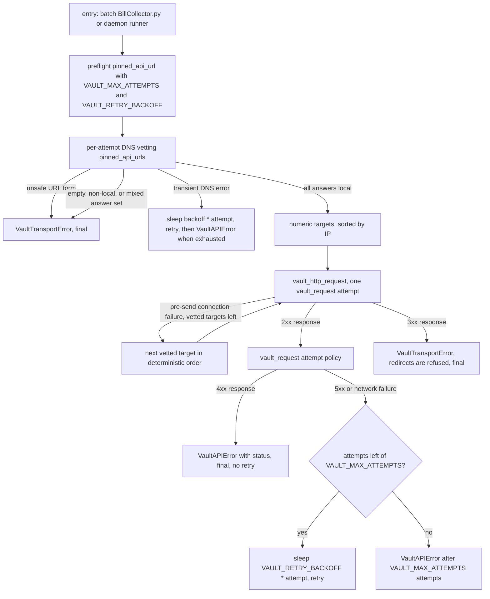

# Vault Transport and Security

BillCollector resolves task credentials from a **local `bw serve`** API (Vaultwarden CLI mode), never from the remote Bitwarden Cloud or Vaultwarden server. Two modules split the job:

- `apps/vault_transport.py` — the transport: validates `BW_API_URL`, vets DNS on **every attempt**, pins the connection to numeric local addresses, and enforces session policy (no ambient proxies, no redirects, sanitized network errors).
- `apps/billcollector/vault.py` — the shared client: explicit timeouts, the retry policy, and the `VaultAPIError` contract used by both operating modes.

The full policy, including operational notes on `BW_API_HOST` and the breaking change history, lives in [doc/vault_transport.md](../../doc/vault_transport.md) — this page records what is refused, where, and why.

## Request flow

Vault request flow from the entry points to final errors: DNS vetting and target pinning happen in `vault_transport.py`; the retry loop and 4xx handling live in `billcollector/vault.py`.

## What is refused, and where

All vetting happens **before any connection is made**, in `pinned_api_urls` (`apps/vault_transport.py`):

| Refusal | Enforced in | Result |
|---|---|---|
| Non-HTTP scheme (HTTPS), missing hostname, URL credentials, query string, fragment, port 0 | `pinned_api_urls` URL check | `VaultTransportError`, final — HTTPS is refused because `bw serve` itself speaks HTTP |
| DNS answer outside local ranges: loopback `127.0.0.0/8` + `::1`, RFC 1918 `10.0.0.0/8` `172.16.0.0/12` `192.168.0.0/16`, IPv6 ULA `fc00::/7` | `pinned_api_urls` `LOCAL_NETWORKS` check | `VaultTransportError`, final |
| Empty answer set, or **mixed** answers (one local + one public) — every DNS answer is vetted | `pinned_api_urls` `LOCAL_NETWORKS` check | `VaultTransportError`, final |
| Non-transient DNS failure (`socket.gaierror` outside the transient set) | `pinned_api_urls` error handler | `VaultTransportError`, final |
| Non-ASCII Host or Host with whitespace/control characters (CRLF injection) | `vault_http_request` `BW_API_HOST` validation | `VaultTransportError` before connection |
| Ambient proxy environment (`HTTP_PROXY` etc.) | `vault_http_request` `session.trust_env = False` | proxies are ignored entirely |
| HTTP redirects (3xx) | `vault_http_request` `allow_redirects=False` + status check | `VaultTransportError`, final — not retried |
| Replay of a request on another address after it was sent (read timeout, reset, partial response) | `vault_http_request` fallback guard | exception re-raised; fallback happens only on pre-send connection failures |

**Transient DNS** errors (`EAI_AGAIN`, `EAI_NONAME`, `EAI_FAIL`, `EAI_NODATA`) are the exception: they surface as a `requests` `ConnectionError` and are retried under the caller's policy. `pinned_api_url(url, attempts=3, backoff=2)` retries preflight DNS with `backoff * attempt` sleeps (2 s, 4 s) and raises `VaultTransportError` when exhausted — so a `bw serve` container being recreated is waited for, while policy failures (non-local, mixed, invalid URL) stay final.

**Address fallback**: `vault_http_request` re-runs DNS per request, then tries the sorted numeric targets only when connection setup failed *before sending* (`ConnectTimeout`, or `MaxRetryError` wrapping `NewConnectionError`). The per-attempt connect budget is shared across addresses (`timeout / len(targets)`); the read timeout stays the full `VAULT_TIMEOUT`, and a read timeout never triggers fallback — correct for non-idempotent calls like `POST /sync`. Network exceptions are re-raised with their class kept but the message replaced (exceptions can carry the URL, credentials, or a body), and 4xx response bodies are logged as status only.

The Host header defaults to the configured API host/port; `BW_API_HOST` optionally overrides it for a `bw serve` in another container (`bw serve` accepts only `Host: 127.0.0.1:<port>` as its DNS-rebinding protection). This is **target enforcement, not API authentication** — `bw serve` must remain on a trusted private network, and the vault backend itself may be cloud-hosted while its CLI API stays local. `VAULT_HOST` is no longer used.

## Shared client contract (`billcollector/vault.py`)

Both the batch entry point and the daemon runner use this single client. Constants: `VAULT_TIMEOUT = 10` s per request, `VAULT_MAX_ATTEMPTS = 3` total attempts, `VAULT_RETRY_BACKOFF = 2` s (delay before retry N is `backoff * N`).

- `vault_request` retries **transient** failures only: transport errors, timeouts (`requests.RequestException`), and 5xx responses, with linear backoff. A **4xx is final**: it raises `VaultAPIError` carrying the `status` code immediately, so callers can distinguish expected statuses from real failures. Exhausted attempts raise `VaultAPIError` without a status. `VaultTransportError` is wrapped as a statusless `VaultAPIError` — configuration and policy failures never retry.
- `get_totp` treats a 400 from the TOTP endpoint as **expected, not a failure**: the item exists (it was fetched directly above) but has no TOTP entry, so it returns `None` and the run continues without an OTP. Any other 4xx is re-raised.
- The module never calls `sys.exit`; it raises `VaultAPIError` and lets callers decide. `fetch_credentials` resolves one task's portal credentials as the name-based link item `<service> <user>` and returns `{"user", "password", "otp", "url"}` with `otp` possibly `None`.

## Callers

- **Batch** (`apps/BillCollector.py`, `WebRetriDoc`): preflights with `pinned_api_url(self.api, VAULT_MAX_ATTEMPTS, VAULT_RETRY_BACKOFF)` — a `VaultTransportError` (unsafe or unreachable URL) exits 1 before any vault call; `bitwarden_api_check_status` must then report `unlocked` or the run exits 1. Per-pair `VaultAPIError`s abort only that service/user pair; the process exits 1 at the end if any pair failed.
- **Daemon runner** (`apps/billcollector/runner.py`, `_vault_preflight`): reads `BW_API_URL` (missing → `VaultTransportError`), runs the same preflight, requires `unlocked`, and fetches credentials; any vault failure marks the run `failure` before the step loop starts. `_fresh_otp` re-fetches the item's TOTP at `{{OTP}}` substitution time (codes go stale mid-recipe) and falls back to the run-start credential when the item has no TOTP or the fetch fails.

## Verification

- `python -m unittest tests.test_vault_transport -v` — expected: all tests OK (DNS and HTTP fully mocked, plus a synthetic loopback partial-response server proving a `POST` is received exactly once, i.e. no address-fallback replay).
- `python -m unittest tests.test_vault_diagnostics -v` — expected: all tests OK (guards the sanitized logging of vault responses and network errors).

## Related

- [Architecture Overview](../architecture/overview.md) — where the shared vault client sits in both operating modes, including the daemon run's preflight position.
- [Shared Interfaces](../architecture/shared-interfaces.md) — the exit-code contract the batch entry point translates `VaultAPIError` into, and the other shared contracts these callers depend on.
