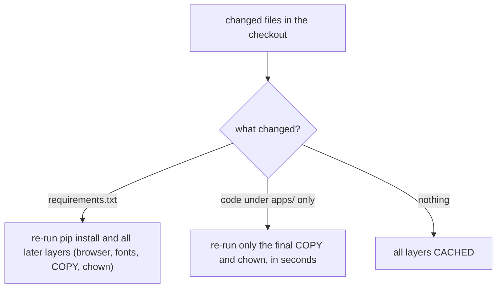
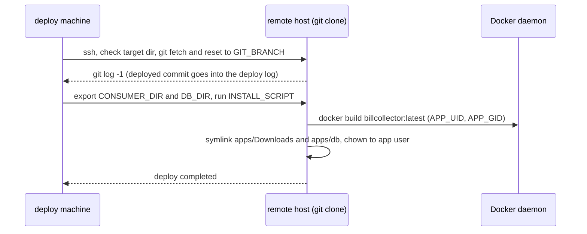

# Development and Deployment

BillCollector has three delivery surfaces, all driven by shell scripts at the repository root:

1. **Local development** — `install_local.sh` prepares a Python virtual environment in `apps/.venv` with the repo-local Playwright Chromium under `apps/browser`.
2. **Image build + host mount setup** — `install_docker-image.sh` builds the single image `billcollector:latest` from `Dockerfile` and (for a NAS-style deployment) turns `apps/Downloads` and `apps/db` into symlinks to shared host directories.
3. **Remote deployment** — `deploy_remote.sh` SSHes to a remote machine with a git clone of the repository, fetches + resets it to the configured branch or release tag, and runs `install_docker-image.sh` there.

This page documents the scripts' behavior and invariants. The step-by-step install walkthrough (cloning, `.env` creation, cron setup) lives in the README's [Quick Start](../../README.md#quick-start) and [Development & Deployment](../../README.md#development--deployment) sections — link out instead of duplicating them.

## Local development environment: `install_local.sh`

`bash install_local.sh playwright` (run from the repository root) prepares a disposable local stack for recipe development and debugging:

- Checks for and installs host prerequisites with `apt-get`: `jq`, `wget`, `curl`, `unzip`, `python3`, `python3-pip`, `python3-venv` (running as root or via `sudo`, which must be present).
- Creates (or reuses) `apps/` and then creates the virtual environment `apps/.venv`, installing the pinned `apps/requirements.txt` into it.
- Installs the browser into the repository: `PLAYWRIGHT_BROWSERS_PATH=$(pwd)/browser playwright install chromium ffmpeg`, so Chromium lands in `apps/browser` — the same layout the daemon uses (`config.BROWSER_DIR` defaults to `apps/browser`, and `config.py` sets `PLAYWRIGHT_BROWSERS_PATH` to it before Playwright is imported).
- Installs the Chrome system dependencies (Xvfb, font packages, GTK/X11 libraries) via `apt-get --no-install-recommends`.

Invariants and failure modes:

- The argument must be exactly `playwright` (kept for compatibility with the pre-multi-engine CLI); anything else exits with usage text.
- `check_for_folder` aborts if the current directory is not `apps` at browser-install time.
- If `apps/browser` already contains subdirectories starting with `chromium` or `ffmpeg`, the script stops and asks for a manual check — it never mixes into an existing browser installation.
- The script prints the re-activation command (`cd apps && source .venv/bin/activate`) for non-sourced invocation. It is tested on Ubuntu 24.04 LTS and WSL2.

Debugging from this environment is `python3 BillCollector.py bc_test.ini debug` (headed Chromium, per-step recording in `apps/db/bc.db`); see the README's [Local Development & Debugging](../../README.md#local-development--debugging) section.

## Image build: `Dockerfile` and `install_docker-image.sh`

The repository has a **single** `Dockerfile` (the legacy Selenium `Dockerfile` is gone, `Dockerfile_pw` was renamed to `Dockerfile`) producing `billcollector:latest`:

- Base `ubuntu:24.04`; an `amd64` guard (`TARGETARCH` must be `amd64` or the build fails with "BillCollector image builds for linux/amd64 only").
- `WORKDIR /apps`, `HOME=/home/billcollector`, `TZ=Europe/Berlin`, and `PLAYWRIGHT_BROWSERS_PATH=/apps/browser`.
- Python dependencies and the browser are installed **before** the application code is copied (see cache ordering below). The per-run display stack (Xvfb virtual screens, `x11vnc`, `websockify`/noVNC live view) and `git` for recipe auto-commits come in a second `apt` step.
- Dependencies are validated with `python3 -m pip check`, then the build-only installers are removed: `apt-get purge -y python3-pip python3-wheel`. Runtime libraries and headed/debug browser support stay; dependency changes therefore require an image rebuild (local venvs keep their installers).
- The app user is a **numeric non-root user** created by `USER ${APP_UID}:${APP_GID}` with build args defaulting to `1000:1000` (no user account entry is needed). Ownership of the whole `/apps` tree and `$HOME` is handed to that user; `/apps/Downloads` is declared as a `VOLUME`; the default `CMD` is `/bin/bash`.

### BuildKit layer-cache ordering

The `Dockerfile` deliberately orders the expensive, rarely-changing steps — python3/pip `apt` install, `pip3 install -r requirements.txt`, `playwright install --with-deps chromium ffmpeg`, the fonts `apt` install — **before** `COPY --chown=${APP_UID}:${APP_GID} apps/ .` and the final `chown`. BuildKit reuses every layer whose inputs are unchanged, so:



*Caption: which layers re-run depends only on the changed inputs, because the build carries no per-commit ARG.*

There is deliberately **no `REVISION` (or similar per-commit) build arg**: a Dockerfile `ARG` value is part of the BuildKit cache key of every `RUN` step, so a value that changes on every deploy would have invalidated the whole layer cache and forced the network-bound pip/playwright rebuild every time. The `REVISION` arg and its `org.opencontainers.image.revision` label were removed for this reason; the only build args are `TARGETARCH`, `APP_UID`, `APP_GID`, `VERSION` (default `dev`) and `SOURCE`. **The deployed commit is recorded in the deploy log, not as an image label** — `deploy_remote.sh` prints `git log -1` after the reset.

`install_docker-image.sh` builds the image with exactly those stable args:

```bash
docker build --build-arg APP_UID="$APP_UID" --build-arg APP_GID="$APP_GID" -t billcollector:latest "$SCRIPT_DIR"
```

- It takes no engine argument; the legacy positional value `playwright` is still accepted for back-compat with older `.env` files, and more than one argument is a usage error.
- The build context is the script's own directory, so it works from any working directory.
- `APP_UID`/`APP_GID` (default `1000`) keep the image's runtime user in sync with the host-side `chown` of the mount targets below.
- `.dockerignore` keeps runtime artifacts out of the build context (see below).

### NAS bind-mount setup (and `SKIP_MOUNT_SETUP`)

The paperless consumer folder and the database folder are **not hardcoded**. `install_docker-image.sh` resolves `CONSUMER_DIR`/`DB_DIR` in this order:

1. Environment variables of the same names (`deploy_remote.sh` forwards them from the deploy machine's `.env`);
2. A `.env` file **next to the script** — parsed line by line as plain `KEY=VALUE` only (no shell code is executed), restricted to the keys `CONSUMER_DIR`, `DB_DIR`, `APP_UID`, `APP_GID`, `SKIP_MOUNT_SETUP`, and only filling variables that are not already set;
3. Otherwise the script errors out **before building anything**.

Both values must be absolute paths to existing directories; validation happens up front so a misconfiguration fails immediately instead of at the first production run.

When mount setup is active (the default), after a successful build the script:

1. Replaces `apps/Downloads` and `apps/db` with symlinks to `CONSUMER_DIR` and `DB_DIR`. A **real, non-empty directory is never replaced** (it would destroy local data, e.g. on a dev machine); existing symlinks (previous installs) and empty directories are. If a refusal triggers, the script exits and points to `SKIP_MOUNT_SETUP=1` for local builds.
2. `chown`s `CONSUMER_DIR` (top level) and `DB_DIR` (recursive) to `${APP_UID}:${APP_GID}` so the container's non-root user can write the shared download folder and database. A `chown` failure aborts the deploy here, not the next cron run.

`SKIP_MOUNT_SETUP=1` skips the symlink + `chown` step entirely (`apps/` is left untouched) — this is how to build the image locally on a dev machine without NAS mount targets.

## Remote deployment: `deploy_remote.sh`

`deploy_remote.sh` runs on a machine holding a clone of the repository plus a root-level `.env` (template: `.env.example`). It requires the keys `REMOTE_USER`, `REMOTE_HOST`, `REMOTE_PATH`, `INSTALL_SCRIPT`, and `GIT_BRANCH` — missing keys or a missing `.env` abort immediately. The root `.env.example` additionally documents `INSTALL_SCRIPT_ARGS` (no arguments needed; the legacy `playwright` value is tolerated) and the two forwarded mount targets `CONSUMER_DIR`/`DB_DIR`.



*Caption: one SSH session fetches + resets the remote clone, then builds the image and sets up the host mount targets.*

Inside the remote `set -e` shell the script, in order: verifies `whoami` and that `REMOTE_PATH` exists; checks `git` is installed; then the **tag-aware reset**:

- `GIT_BRANCH` starting with `v` (a release tag): `git fetch --tags origin` followed by `git reset --hard <tag>`. Pointing `GIT_BRANCH` at a validated tag and re-running the script is the **one-command rollback** of a deployment.
- Any other value (a branch): `git fetch origin <branch>` followed by `git reset --hard origin/<branch>`.

Every failure (fetch, reset, missing install script) exits non-zero, so a half-reset never reaches the build step. After the reset, `git log -1` prints the commit that is about to be deployed — this line in the deploy log is the traceability record, since the image carries no revision label. The script then `export`s `CONSUMER_DIR`/`DB_DIR` (empty values are treated as unset on the remote, which falls back to the `.env` next to the script), `chmod +x`es `INSTALL_SCRIPT`, and runs it with `INSTALL_SCRIPT_ARGS`.

## Trunk-based model, release tags, no CI

Development is trunk-based with release tags ([README](../../README.md#development--deployment), [CONTRIBUTING.md](../../CONTRIBUTING.md)):

- **`main`** is the verified production state: it only moves forward once a milestone has been validated in a production run, so `main` is always safe to deploy from.
- **Release tags** (e.g. `v0.3`, `v0.4`) are snapshots of validated releases, for pinning a deployment or rolling it back — either by pointing `GIT_BRANCH` at the tag in `deploy_remote.sh`'s `.env` and re-running, or by checking the tag out in a clone and rebuilding the image.
- There is **no CI pipeline**: changes are validated in the [local regression test environment](../../README.md#local-regression-test-environment) and in production runs before being integrated. (The only workflow in `.github/workflows/` is the scheduled wiki refresh, not a build/test pipeline.)

## Public mirror model

Day-to-day development happens on a private upstream repository that is not mirrored here. Once a milestone has been validated, it is promoted to the private production branch and the public copy is updated accordingly, so `main` reflects the published production state, not in-flight work.

The public copy is a **sanitized mirror**, refreshed by a maintainer-only sync script that stays out of the public repository itself:

- It fetches the published branch of the private upstream and checks it out **detached in a throwaway git worktree** — the main working tree and the current branch are never touched.
- It strips the internal directories `.kilo`, `.vscode`, `.private`, and `openwiki` from the staging area before publication (so the wiki tree itself ships only in the private copy).
- If anything was removed, it amends the tip commit reusing its original message and author and **pinning the committer date to the source commit**, so the amend is deterministic — re-running the sync must not rewrite the public branch to a new hash.
- It force-pushes the sanitized state to the public `main`; with an optional tag argument it also force-pushes the matching release tag. The sanitized commit's hash differs from the private tip by design, so a tag on the public repository points at the sanitized commit, not the private one.

The repository must stay publishable as-is: no internal hostnames, paths, or personal setup details may appear in public sources. The `SOURCE` build arg in the `Dockerfile` likewise points at the public repository.

## Environment surface

### `apps/.env` — and the breaking mount rule

The image **no longer contains `apps/.env`** (excluded via `.dockerignore`): credentials never enter the image. `BillCollector.sh` mounts the host file read-only at `/apps/.env` for every run:

```bash
docker run -v "$SCRIPT_DIR/apps/.env:/apps/.env:ro" \
        -v $SCRIPT_DIR/apps/Downloads:/apps/Downloads \
        -v $SCRIPT_DIR/apps/db:/apps/db \
        --rm billcollector:latest python3 ./BillCollector.py $1 $2
```

Any **direct `docker run`, compose file, or scheduler must add the same read-only mount** or the container starts without configuration. `.env` changes take effect at the next run without a rebuild; INI files and recipes are baked into the image and need a rebuild. The wrapper also holds an exclusive non-blocking `flock` on `apps/.bc.lock` for the whole `docker run` (rejecting overlapping starts) and refuses to start unless `apps/.env` exists and is readable.

`apps/.env.example` documents the application keys:

- `BW_API_URL` — the local `bw serve` HTTP URL; it must be plain HTTP resolving only to loopback/private addresses (HTTPS and public targets are refused — see [Vault Transport and Security](../concepts/vault-transport.md)).
- `BW_API_HOST` (optional) — Host header for a `bw serve` in another container.
- `BC_CHROMIUM_ARGS` (optional) — extra Chromium launch arguments; a dev-host (e.g. WSL2) launch workaround, unset in production.
- `BC_UI_HOST` (optional) — daemon UI bind host (default `127.0.0.1`; `0.0.0.0` inside the container).

### Daemon: `.env` loading, `BC_*` path overrides, Settings table

The daemon's configuration layering is: **code defaults → `apps/.env` → `BC_*` environment variables → the SQLite `Settings` table**, with later layers winning where they apply:

- `config.load_env()` loads `apps/.env` into `os.environ` with `override=False` — already-exported values always win, so the same file works for the batch entry point (`BillCollector.py` calls `load_dotenv()`) and the daemon (`runner`/`cli` call `config.load_env()`).
- **`BC_*` environment variables override the daemon's filesystem paths**: `BC_DATA_DIR`, `BC_DB_DIR`, `BC_DB_FILE`, `BC_LOG_DIR`, `BC_BROWSER_DIR`, `BC_PROFILE_ROOT`, `BC_DOWNLOAD_DIR` (defaults under `apps/` in `billcollector/config.py`). This redirection exists primarily to keep the test suite from touching production `apps/` data.
- **The `Settings` table in `apps/db/bc.db` overrides the code defaults at runtime**: `db.get_setting(key)` returns the stored row if present, otherwise `config.DEFAULT_SETTINGS[key]`. Defaults include `pause_deadline_seconds` (1800), `max_concurrency` (1), `display_start` (99) and `display_count` (16) for the Xvfb pool, `git_commit_enabled` (false), `ui_base_url`, `ntfy_topic`, `download_dir`, and `vnc_password` (empty — noVNC is localhost-only). Values are stored as TEXT; the UI owns writing them.

### `.dockerignore`

`.dockerignore` keeps local credentials and runtime artifacts out of the Docker build context: `**/Downloads`, `.git`, `**/.env` and `**/.env.*` (with `!**/.env.example` retained), `**/*.log` and `**/*.log.*`, `**/*.bak`, `**/*.html` except the mock-portal test templates (`!tests/mock_portal/templates/*.html`), `**/chrome*`, `**/.pytest*`, `**/.bc.lock`, `**/.code`, `**/.venv`, `**/__pycache__`, and the runtime directories `apps/browser` and `apps/db`. To prove the exclusions hold, `tests/check_docker_context.py` (Docker + BuildKit) builds a `FROM scratch; COPY . /` image from a canary-filled scratch context — expected output: `Docker context: 19 private canaries excluded, 5 source files retained` (see the README's [Docker Build Context Check](../../README.md#docker-build-context-check) section).

## Verification

```bash
# local dev stack (repo root, Ubuntu 24.04 / WSL2)
bash install_local.sh playwright

# image only, no NAS mount setup
SKIP_MOUNT_SETUP=1 bash install_docker-image.sh

# full NAS-style install on the target machine (needs CONSUMER_DIR/DB_DIR)
bash install_docker-image.sh

# remote deploy / tag rollback (root .env set, e.g. GIT_BRANCH=v0.4)
bash deploy_remote.sh

# build-context exclusions still hold after touching .dockerignore or the Dockerfile
python3 tests/check_docker_context.py
```

Re-running `install_docker-image.sh` (or `deploy_remote.sh`) against an unchanged tree should produce an all-`CACHED` build; a code-only `apps/` change re-runs only the final `COPY` + `chown`. If a deploy resets to a commit whose `requirements.txt` differs, expect the pip/browser layers to re-run.

## Related pages

- [Architecture Overview](../architecture/overview.md) — batch vs daemon modes sharing the same image and SQLite file.
- [Vault Transport and Security](../concepts/vault-transport.md) — what `BW_API_URL` must and must not be.
- [Quick Start](../quickstart.md) — the operator walkthrough this page complements.
- [Testing and Verification](../testing/verification.md) — regression harness and checks.
