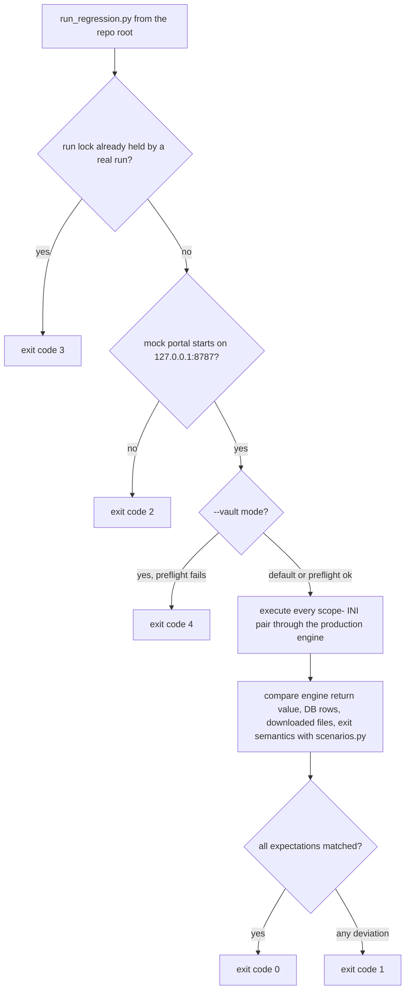

# Testing and Verification

BillCollector has **no CI pipeline** ([CONTRIBUTING.md](../../CONTRIBUTING.md), "How development works"): changes are validated in the local regression test environment and in production runs before they are integrated. The [CONTRIBUTING.md](../../CONTRIBUTING.md) "Proof" rule makes this concrete - **every PR ships with a test or check that proves the behaviour** (a regression scenario, a unit test, a schema validation, or a documented manual run), and every documented behavior below states its command and expected result the same way: run this from the repository root, expect this.

Three verification surfaces cover the system:

1. The **regression harness** (`tests/run_regression.py` + `tests/mock_portal/` + `tests/scenarios.py`) - end-to-end behavior of the production scraping engine against a local mock portal.
2. The **pytest suite** (`pytest.ini`, `apps/requirements-dev.txt`) - unit and UI tests for the daemon, with a fresh temp database per test.
3. The **Docker build context check** (`tests/check_docker_context.py` against [.dockerignore](../../.dockerignore)) - canary proof that runtime artifacts never enter the image.


*Caption: the regression harness's control flow; codes 2-4 mark environment failures so that only a green `0` certifies engine behavior.*

## Regression harness

The environment (README, "Local Regression Test Environment"; introduced in [CHANGELOG.md](../../CHANGELOG.md) v0.4) is a self-contained three-part setup that tests the scraping engine **against a local mock portal instead of the real web services**:

- `tests/mock_portal/` - a small web portal (ASGI/uvicorn on `127.0.0.1:8787`) with sites covering the main scenarios.
- `tests/scenarios.py` - the expected outcome of every (service, user) pair.
- `tests/run_regression.py` - the harness: starts the mock portal, executes every pair of a scope INI through the production scraping engine, and checks the engine return value, the DB rows, the downloaded files, and the exit semantics.

### Command and expected result

From the repository root:

```bash
apps/.venv/bin/python tests/run_regression.py --ini tests/bc_regression.ini
```

**Expected result: exit code `0`** with all per-pair expectations matched. This is also the verification command the [CONTRIBUTING.md](../../CONTRIBUTING.md) "Local development" section names for verifying a change from the repository root. Useful options:

- `--ini tests/bc_regression_happy.ini` - success-only scope (faster green check; the full scope above is the one that must pass, because its failure scenarios are intentional).
- `--keep-downloads` - don't delete the test downloads afterwards.
- `--port <n>` - run the mock portal on a different port.
- `--vault` - the end-to-end mode, below.

### Behavioral matrix

The mock portal's scenario sites (README, "Local Regression Test Environment") form the behavioral matrix; each scenario's expectations live in `tests/scenarios.py` and are matched per (service, user) pair:

| Scenario | What it exercises | What a green run proves |
| --- | --- | --- |
| Happy path with OTP and downloads | full login incl. `{{OTP}}` substitution, `expect_download` steps saving into the Downloads folder | engine returns success, DB rows recorded, downloaded files present |
| Bad login | a failing non-graceful step aborts the pair | run aborted and finalized as `failure` in the DB, pair failure isolated |
| Graceful step failure | a step with `graceful: true` records its failure and continues | failure row recorded, run continues, final result still success |
| Download failure | the download never arrives (or errors) | `failure: download ...` recorded, pair fails without hanging |
| Empty document list | the portal has nothing to download | the pair fails cleanly - success requires at least one downloaded file |
| CAPTCHA-style friction | an interactive obstacle the recipe must get past | the engine's step handling of friction pages works |

### Exit codes 0-4

```
0  all expectations matched
1  at least one expectation deviated
2  the mock portal could not be started
3  a real BillCollector run holds the run lock
4  the --vault preflight failed
```

The codes are deliberately diagnostic, not a single pass/fail bit: `1` says *behavior deviated*, while `2`-`4` say *the environment was not ready* (portal, lock, vault). A green run (`0`) is what certifies that the engine's return values, DB rows, downloads, and exit semantics all matched.

### `--vault` end-to-end mode

The same command plus `--vault`:

```bash
apps/.venv/bin/python tests/run_regression.py --ini tests/bc_regression.ini --vault
```

This switches the harness from its self-contained mode to an end-to-end mode against a **real Vaultwarden**: it prefights the vault (env, DNS, unlock, sync) and fetches credentials, URL, and TOTP from the corresponding vault items instead of `tests/scenarios.py`. **Expected result: exit `0` on a provisioned vault; exit `4` if the preflight fails.** It requires a vault provisioned with the test items - the maintainer's dev setup - which is why the default mode (no vault, fully self-contained) is the one everyone runs. The vault preflight itself exercises the same pinned local-URL/unlock/sync sequence the production entry point runs (see [Vault Transport and Security](../concepts/vault-transport.md)).

### What the harness proves about the shared interfaces

The harness drives the **production batch path** - the same `retrieve_from_service_with_playwright` that `BillCollector.py` calls per pair - so a green run is not a unit test of a copy: it executes the real recipe validation, the real step loop, and the real DB finalization. The [shared interfaces](../architecture/shared-interfaces.md) that a green regression run therefore proves together:

- **Recipe contract** - every pair starts with `CheckRecipe` against `recipe-pw-schema.yaml` in the engine; a scenario whose recipe did not validate would deviate.
- **Exit codes (batch side)** - the harness's "exit semantics" check compares the engine's return value against the pair-failure isolation contract: a failed (service, user) pair aborts only its own run, the remaining pairs run, every started run is finalized in the DB, and the process exits `1` if any pair failed ([BillCollector.py](../../apps/BillCollector.py), `WebRetriDoc`; [BillCollectorServices_pw.py](../../apps/BillCollectorServices_pw.py) `finalize_service_run`). The harness's own codes 0-4 document the same shared-interface table for the test process.
- **Schema (batch side)** - the per-run `Service`/`PageStatus_<service>_RunN` rows the harness reads back are the legacy batch schema in `bc.db`.

The **control protocol** has no harness coverage: it is daemon-only (one Unix socket per paused run, see [Shared Interfaces](../architecture/shared-interfaces.md) section 2), and it is verified by the pytest suite instead.

## pytest suite

The committed unit/UI suite is configured at the repository root in [pytest.ini](../../pytest.ini):

```ini
[pytest]
testpaths = tests
addopts = -p nicegui.testing.user_plugin
asyncio_mode = auto
main_file = tests/ui_test_main.py
```

- The **NiceGUI `User` fixture** (from `nicegui.testing.user_plugin`) runs UI tests in-process with no browser. The packaged `nicegui.testing` plugin would also pull in selenium for the `Screen` fixture, which this repo's committed suite does not use.
- `asyncio_mode = auto` is required because the `User` fixture is an async fixture that needs an event loop.
- `main_file` names the main file the `User` fixture executes for UI tests.
- **Fresh temp DB per test**: `apps/billcollector/config.py` redirects every daemon path (`BC_DATA_DIR`, `BC_DB_DIR`, `BC_DB_FILE`, `BC_LOG_DIR`, `BC_BROWSER_DIR`, `BC_PROFILE_ROOT`, `BC_DOWNLOAD_DIR`) via `BC_*` environment variables, which "keeps the test suite from touching the production `apps/` data" - each test gets a fresh temporary database instead of sharing `apps/db/bc.db`.

The dev-only dependencies live in [apps/requirements-dev.txt](../../apps/requirements-dev.txt) and are **never in the runtime `requirements.txt`** (so the production image never carries them):

- `pytest==9.1.1`, `pytest-asyncio==1.4.0`, `ruff==0.17.0`.

Command and expected result, from the repository root (comment in `apps/requirements-dev.txt`):

```bash
apps/.venv/bin/python -m pytest tests/ -q
```

**Expected result: exit `0` - all tests pass.** Companion lint check from the same file:

```bash
apps/.venv/bin/python -m ruff check apps tests
```

expected: no findings (config: `ruff.toml` at the repo root).

## Docker build context check

The [.dockerignore](../../.dockerignore) keeps local credentials, logs, browser sessions, and other runtime artifacts out of the Docker build context (`**/.env` and `**/.env.*` with `!**/.env.example` retained, `**/*.log*`, `**/*.bak`, `**/.venv`, `**/__pycache__`, `**/.pytest*`, `**/.bc.lock`, `**/chrome*`, `apps/browser`, `apps/db`, `**/Downloads`, and `**/*.html` except the mock-portal templates). To prove the exclusions really hold, `tests/check_docker_context.py` builds a **worst-case image** (`FROM scratch`, `COPY . /`) from a scratch context filled with synthetic canary files - no real checkout data, no registry access - and checks that every excluded artifact stays out of the image while every source file stays in.

Command and expected result, from the repository root, on a machine with Docker and BuildKit (README, "Docker Build Context Check"):

```bash
python3 tests/check_docker_context.py
```

**Expected output:**

```
Docker context: 19 private canaries excluded, 5 source files retained
```

Useful option: `--dockerignore <path>` to check a different `.dockerignore` (e.g., a previous version as a negative control). **Run this check whenever you change the `.dockerignore`, the [Dockerfile](../../Dockerfile), or add new runtime artifacts** - it is the only check that proves the "no secrets in the image" boundary, which matters because [Dockerfile](../../Dockerfile) installs Python dependencies and the Playwright browser *before* copying the application code, so anything the context check lets through would be baked into cached layers (see [Development and Deployment](../operations/deployment.md)). The hardening itself is tracked in [CHANGELOG.md](../../CHANGELOG.md) ("Exclude local credentials, logs, browser sessions and other runtime artifacts from Docker build contexts", Unreleased).

## Verification surface map

Which check proves which shared interface:

| Shared interface | Proven by | Command / expected result |
| --- | --- | --- |
| **Schema** (SQLite) | pytest suite for the daemon tables (`Task`/`Run`/`PageStatus`/`Download`/`Settings`); regression harness for the legacy batch rows (`Service`, `PageStatus_<service>_RunN`) it reads back per run | `apps/.venv/bin/python -m pytest tests/ -q` (all pass); harness exit `0` |
| **Control protocol** (daemon, socket v1) | pytest suite only - the protocol is daemon-only and has no regression-harness coverage | `apps/.venv/bin/python -m pytest tests/ -q` (all pass) |
| **Recipe contract** (YAML + schema) | regression harness (every pair starts with `CheckRecipe` in the production engine); `helpers/BillCollectorCheckRecipe.py` for a single recipe | harness exit `0`; `python3 helpers/BillCollectorCheckRecipe.py <recipe.yaml> [<schema.yaml>]` (validates) |
| **Exit codes** | regression harness checks the batch engine's per-pair exit semantics as part of its expectations and documents its own 0-4 codes | harness exit `0` (expectations matched) |

The [Proof](../../CONTRIBUTING.md) rule ties this back to contribution practice: a PR that touches any of the four shared interfaces must reference the agreeing issue and state the command and expected result that prove the change - typically a new or extended regression scenario, a pytest test, or the docker context check above.

## Related pages

- [Shared Interfaces (Contracts)](../architecture/shared-interfaces.md) - the four contracts this page's checks prove.
- [Recipe System](../concepts/recipes.md) - what the harness's scenario recipes exercise.
- [Development and Deployment](../operations/deployment.md) - the build whose context the canary check guards.
