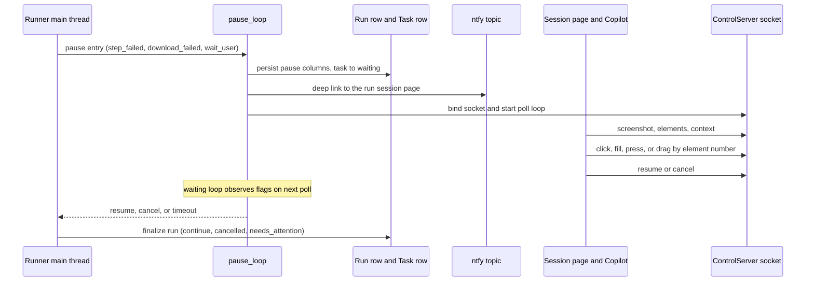

# Pause, Intervention & Recipe Repair

A stuck daemon run does not abort: it **pauses**, persists a machine-readable context, and hands the page to the operator. The whole mechanism lives in three modules - `apps/billcollector/pause.py` (context, persistence, waiting loop), `apps/billcollector/control.py` (the versioned control socket), and `apps/billcollector/notify.py` (the ntfy deep link) - and the repair flow reuses it through the session page and the recipe editor. This page is the operator and developer playbook for that loop; the protocol and context are also **shared interfaces** documented on [Shared Interfaces](../architecture/shared-interfaces.md).

## The three pause entry points

All three live in `runner.py` and funnel into `pause_loop` (`pause.py`):

| Entry point | Reason | Triggered when | Outcome mapping |
| --- | --- | --- | --- |
| `_execute_step_with_pause` | `step_failed` | a non-graceful step exhausts its `MAX_STEP_ATTEMPTS = 3` attempts (graceful steps are single-attempt and never pause) | `resume` re-executes the step with a fresh budget |
| `_handle_download_with_pause` | `download_failed` | the `expect_download` window's download fails | `resume` re-executes the download step |
| `_execute_wait_user_step` | `wait_user` | an explicit `wait_user` recipe step - the pause happens **before** execution and the step is consumed, not re-executed, on resume | `resume` completes the step |

## What a pause does: `pause_loop`

`pause_loop(ctx, reason, prompt, step_action_json, error, step_number)` runs in the runner's **main thread** between steps, so the synchronous Playwright calls inside the action handlers are safe. In order it:

1. **Computes the deadline**: `pause_deadline_seconds` from the Settings table (default `1800`) from now, and bumps `ctx.pause_count`.
2. **Builds the context** (`build_pause_context`): a best-effort, never-raising page snapshot - `reason`, `prompt`, the page `url`/`page_title`/`page_text` (capped at `PAUSE_PAGE_TEXT_CAP = 20000` characters), a pause screenshot saved to `pause_<n>.png` in the run directory (path + base64), the failing step's parsed locator-action JSON as `step` (plus the additive `step_number` payload key so a consumer can find the step in the recipe without parsing the prompt), the numbered interactive-element scan, and `deadline_at`. A degraded context is still a context; only `RunInterrupted` (a shutdown signal) always propagates.
3. **Persists it** (`persist_pause`): writes `pause_reason`, `pause_prompt`, `pause_context` (JSON), `pause_deadline_at` on the Run row and flips the task to `waiting` - so the scheduler's row lock (`claim_task_run`) cannot re-trigger the task while it is paused.
4. **Pushes the ntfy deep link** (`notify.notify_pause`): a best-effort POST to the `ntfy_topic` setting with title `BillCollector: <service> <user> needs attention`, the pause prompt, and the link `<ui_base_url>/runs/<run_id>` (the session page). A failed push is logged and never affects the run; an empty topic skips it.
5. **Serves the control socket**: binds `run-<run_id>.sock` under the run directory (recorded on `Run.control_sock`), then polls every `PAUSE_POLL_SECONDS = 0.5` s, returning `"resume"`, `"cancel"`, or `"timeout"` when the respective flag/deadline is hit. The socket file is unlinked in the `finally` on every exit path.

The **pause outcome is terminal in itself**: `resume` continues the run (re-executing the failing unit with a fresh budget); `cancel` ends the run `Run.result = cancelled`; the deadline timeout ends it `Run.result = needs_attention`. The runner's teardown then finalizes the row and returns the task to `idle` (see [Run Lifecycle](run-lifecycle.md)). The Run row's pause columns are **not** cleared when a pause resolves - the ended session view still shows the last pause context, which is why the session page decides "waiting" by the control socket's liveness, not by `pause_reason` alone.

## The control socket

The protocol itself - message shape, action list, versioning rule, limits - is the [Shared Interfaces](../architecture/shared-interfaces.md) contract: `PROTOCOL_VERSION = 1` JSON lines over one Unix socket per paused run; actions `screenshot`, `elements`, `context`, `click {n}`, `fill {n, text}`, `press {key}`, `drag {n, dx, dy}`, plus the reserved `resume` / `cancel`.

Implementation notes specific to this loop:

- **`resume` / `cancel` are flags, not handler results** - the server sets `resume_requested` / `cancel_requested` and the waiting loop observes them on the next poll (passing them as handlers raises `ValueError` at construction).
- **Actions are coordinate-based** (`make_action_handlers`): every element action re-scans the page fresh (`_number_elements(scan_elements(page))`), resolves element `n` to its `rect` center, and acts on those viewport coordinates (`page.mouse.click`, `page.keyboard.type`, `page.mouse.move/down/up`). An unknown `n` is a `ValueError` reported to the client as `ok: false`; the pause stays active.
- **A failed action never kills the pause** - the error is returned to the client and the loop keeps serving. `RunInterrupted` always propagates (a shutdown during a pause takes the full teardown).
- **The UI side** opens a short-lived `ControlClient` per request from a worker thread, so the blocking socket call never sits on the NiceGUI event loop (session page).

## The operator loop (session page)

The ntfy deep link lands on `/runs/<run_id>` (`apps/billcollector/ui/session.py`). While `waiting`, the page shows:

1. The **pause banner** - reason, prompt, deadline countdown.
2. The **Copilot tab** (default): the live screenshot with a numbered overlay (badges positioned by percentage over the PNG, read from the image's `IHDR` chunk), the element select (`n · role · name`), the action bar restricted to each element's `actionTypes`, and **Resume** / **Cancel** (Cancel confirms, then sends the protocol `cancel`). Screenshot/elements refresh every ~5 s and immediately after every action.
3. The **noVNC tab**: the run's websockify port as an iframe - the escape hatch when the scan finds **no** interactive elements (the standing case: a drag CAPTCHA), where the Copilot view shows a hint pointing here instead of an error.

*Caption: one pause - the context is persisted and announced before the socket binds, the operator works the page through the Copilot view or noVNC, and the outcome is terminal: continue, cancel, or deadline timeout.*

## Recipe repair from a paused run

For a `step_failed` pause, the session page offers **Repair recipe** (while `waiting` and after the run has ended): it opens `/recipes/<service>?run=<run_id>` and the recipe editor preloads the **failure panel** from `Run.pause_context` (`failure_panel_data` in `ui/recipes.py`):

- the failure screenshot (a `/runfiles` URL), the failed step (number, description, expected locator chain, error), and the candidate rows from the context's `elements` (number, role, name, locator type) - each with a **Use** button.
- **Use** calls `apply_candidate_to_step` (`apps/billcollector/recipes.py`), which replaces the failed step's locator prefix with the candidate's locator, and the editor reloads with the rewritten YAML. The operator then fine-tunes and runs the normal **Validate -> Save -> git-commit** flow (save is atomic; the commit stages exactly the recipe file).

The picker is disabled, with a hint, when it cannot apply: a non-`step_failed` pause (`wait_user`, `download_failed`), a missing or corrupt `pause_context`, a context without a step number, or a step without a locator prefix (including nested `expect_download` steps). This is the full extent of automated repair today - the pause context is the AI-integration contract designed for future automatic intervention, but the flow remains human-in-the-loop ([Roadmap](../architecture/roadmap.md)).

## Invariants

- **A pause is not a failure of the run's process** - the runner keeps its display stack and browser alive while paused; only `cancel`/`timeout` end it.
- **The task is `waiting` for the whole pause** - the scheduler cannot re-trigger it, and a resumed run stays `waiting` (its task) until the run finalizes.
- **The context payload is the AI-integration contract** (decision 20): it must stay complete, stable, and small; protocol changes need a version bump in `control.py` plus a doc update.
- **Every degradation is survivable**: a failed element scan returns `[]` (noVNC hint), a failed screenshot degrades to `null` fields, a corrupt `pause_context` renders its hint instead of killing the page, a failed ntfy push is logged only. `RunInterrupted` is the one exception - a shutdown signal always propagates.

## Verification

- `apps/.venv/bin/python -m pytest tests/ -q` (expected: exit `0`) - the pytest suite covers the control protocol (version rejection, reserved actions, the 4 MiB cap) and the pause/finalization mapping against a scratch DB via the `BC_*` path redirects.
- Manual (the pause loop is daemon-only; the batch regression harness has no pause path): with the daemon running, start a run that hits a failing non-graceful step (or a `wait_user` step in a recipe). Expected: the task flips to `waiting` in the dashboard, an ntfy push lands (when `ntfy_topic` is set), and the session page from the deep link shows the pause banner. Resume and Cancel: `Run.result` ends `success`/`failure` after resume and `cancelled` after cancel, and the task returns to `idle` in both cases.
- Protocol probe: with a run paused, `echo '{"v": 1, "action": "context"}' | socat - UNIX-CONNECT:<run dir>/run-<run_id>.sock` returns `{"v": 1, "ok": true, "context": ...}`; a request with `"v": 2` returns `ok: false` with a version error (see [Shared Interfaces](../architecture/shared-interfaces.md) for the exact shape).

## Related pages

- [Run Lifecycle](run-lifecycle.md) - where the pause entry points sit in the overall run flow.
- [Shared Interfaces](../architecture/shared-interfaces.md) - the control-protocol and schema contracts this page depends on.
- [Web UI Pages](../ui/web-ui.md) - the session page, recipe editor, and ntfy deep link as UI surfaces.
- [Recipe System](../concepts/recipes.md) - the YAML the repair flow rewrites.
- [Roadmap: Daemon Migration Status](../architecture/roadmap.md) - what is deliberately still open (AI-driven intervention, self-healing).
