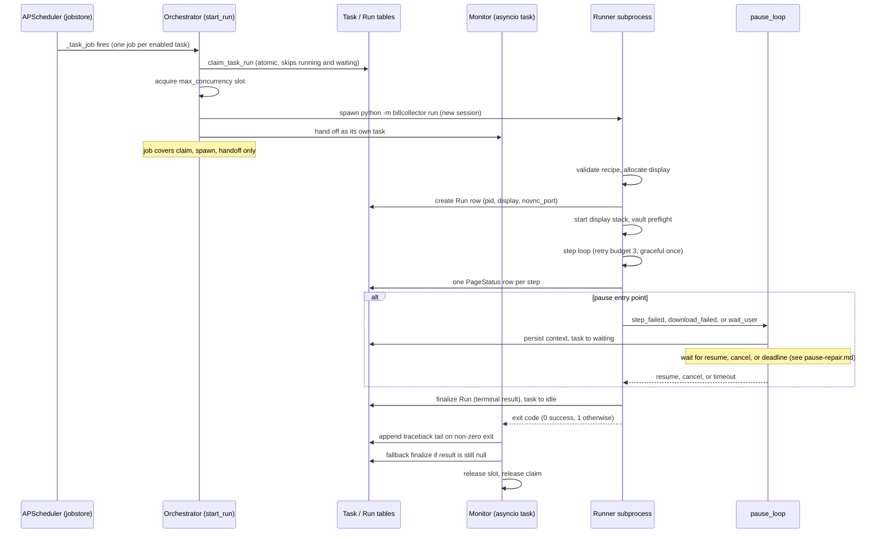

# Run Lifecycle: Scheduling, Locking, and Step Recording

BillCollector runs documents in two coexisting modes, and both have a full run lifecycle: the **batch mode** is a cron-launched, one-shot, headless process that walks every (service, user) pair of an INI file, while the **daemon mode** is a long-running NiceGUI server that schedules one isolated runner subprocess per Task. This page traces a run from the moment a schedule fires (or a cron line invokes the wrapper) through claim, spawn, the step loop, and Run finalization, in both modes, and marks where pauses are entered. The state machines and shared contracts are summarized on [Architecture Overview](../architecture/overview.md); the protocol and schema contracts are on [Shared Interfaces](../architecture/shared-interfaces.md); the pause/repair loop itself is covered on [Pause and Repair](pause-repair.md).

The two modes share the SQLite file (`apps/db/bc.db`, WAL mode, `busy_timeout=30000`), the vault client, the recipe files, the `PageState` scan, and the success contract (a run is `success` only when it completed without aborting **and** at least one file downloaded with `result == "success"`), but they write different tables and guard against double starts with different locks.

## Batch mode: cron, the flock guard, and per-pair isolation

The batch entry chain is `BillCollector.sh` (cron wrapper) -> `apps/BillCollector.py` (`WebRetriDoc`) -> `apps/BillCollectorServices_pw.py` (`retrieve_from_service_with_playwright`). The host's cron daemon is what schedules the run; the script takes the INI file (and an optional valued debug switch) as parameters and passes them through to `python3 ./BillCollector.py`.

Two independent layers reject a second concurrent start (overlapping cron starts, a UI run plus a manual run):

1. **The harness `flock`** in `BillCollector.sh`: an exclusive, non-blocking `flock -n` on fd 9 of `apps/.bc.lock`, held for the whole `docker run` (the container's `/apps` is image-owned, so only a host-side lock is visible to two runs). A lost `flock` prints "already running" and the script exits `1`; the kernel releases the lock automatically when the script exits.
2. **The in-process `flock`** via `acquire_run_lock()` in `apps/helpers/BillCollectorHelpers.py`: `BillCollector.py` calls it right before the service loop. It opens `LOCK_FILE` (`apps/.bc.lock`) and takes `fcntl.flock` with `LOCK_EX | LOCK_NB`; on `BlockingIOError` it logs "Another BillCollector run is already in progress" and `sys.exit(1)`. The returned file object is kept alive for the process lifetime (closing the fd releases the lock), so no stale-lock cleanup is ever needed - the kernel releases it even on `SIGKILL`.

Because both guards use the same lock file, the regression harness can detect a live batch run: `tests/run_regression.py` exits **3** when a real BillCollector run holds the run lock (its own code 1 means *behavior deviated*, 2 means the mock portal failed to start, 4 means the `--vault` preflight failed, and only `0` certifies engine behavior - see [Testing and Verification](../testing/verification.md)).

The batch preflight in `WebRetriDoc` is process-fatal: it vets the actual API endpoint with `pinned_api_url` (must resolve only to local addresses), requires `bitwarden_api_check_status` to report `unlocked`, and posts `/sync`. Any of these failing exits `1` immediately - no services run at all (see [Vault Transport and Security](../concepts/vault-transport.md)).

After the preflight, the entry point loops the `[Playwright]` sections of the INI (optionally filtered with `--service <NAME>`), and for each service/user pair:

- fetches the `<service> <user>` vault item, its TOTP, and the login URI. A vault credential error here **aborts only that pair** (`failed = True; continue`) - the remaining services still run;
- calls `retrieve_from_service_with_playwright`, which returns `True` only when the run completed without aborting and at least one file downloaded successfully; a `False` return is likewise isolated to the pair.

At the end, the process exits `1` if **any** pair failed, `0` otherwise. Inside `BillCollectorServices_pw.py`, `perform_actions` runs a `sync_playwright` persistent Chromium context and records every step as a row in the legacy schema - a `Service` registry table plus one `PageStatus_<service>_RunN` table per started run, created in the same `apps/db/bc.db` file. A `finally` block calls `finalize_service_run` for every started service run, so the DB always holds a terminal `success`/`failure` even when the run aborted mid-step.

## Daemon mode: scheduler, claim, spawn

In daemon mode the host scheduler is replaced by an in-process one, and the run unit is one Task (one service/user pair) executed in an isolated subprocess.

### The scheduler mirror

`billcollector/scheduler.py` (`TaskScheduler`) mirrors the **Task table** - the source of truth for what runs when - into an APScheduler `AsyncIOScheduler` backed by a persistent SQLAlchemy jobstore in the **same** `bc.db` file:

- `resync()` (the startup hook) rebuilds the job table: every stored job is dropped and one job is re-added per **enabled** task that carries a **cron** expression. The jobstore is a cache - the Task table always wins.
- `sync_task(task_id)` is the single-task hook for task CRUD (create, enable/disable, cron edit).
- One cron job per task, with job id `task-<id>` and target the module-level `_task_job` (importable by reference, so the jobstore survives a daemon restart). `_task_job` awaits the run callback configured on the scheduler - the orchestrator's `start_run`.
- Job defaults: `coalesce=True` (missed fires collapse), `max_instances=1`, and **no misfire grace window** - a missed monthly run still runs on the next daemon start. The DB row lock (`claim_task_run`) is the second guard.

On the serve startup path (`ui/app.py` `build_lifecycle`), `orchestrator.cleanup_orphans()` runs first and then `scheduler.start()`; on SIGTERM the **scheduler stops first** so no new job can dispatch while runners are being reaped, and then `orchestrator.shutdown()` runs.

### Claim and spawn

`Orchestrator.start_run` (in `billcollector/orchestrator.py`) is the single run entry for scheduler jobs and for the UI's Run now actions (dashboard, task detail, recipe editor). It:

1. **claims the task with the DB row lock** - `claim_task_run` atomically runs `UPDATE Task SET status='running' ... WHERE id=? AND status NOT IN ('running','waiting')` and returns `True` only when this caller won. A task already `running` or `waiting` is skipped, which also guards against a double queue entry for the same task. If the claim is lost, or the task is unknown, `start_run` returns `None` and starts nothing.
2. **acquires the global semaphore** sized by the `max_concurrency` setting (default `1`), so at most that many runners are live at once;
3. **spawns the runner** as `python -m billcollector run <task_id>` via `asyncio.create_subprocess_exec` with `start_new_session=True`, stderr merged into stdout and piped. The new session makes the runner a process-group leader for two reasons: its display-stack children share the group (so one `killpg` takes the whole stack down on shutdown), and a `SIGKILL`ed daemon orphans the runner instead of killing it - the startup orphan cleanup then sees the live pid and leaves the run to its orphaned runner.
4. **hands off to the monitor** - `self._monitors[task_id] = asyncio.create_task(self._monitor(task_id, proc))`. The scheduler job itself only covers claim/spawn/handoff, so a daemon shutdown that stops the scheduler cancels the *job*, not the monitoring of a live runner.

Because the claim, the semaphore wait, and the spawn can all be cancelled (daemon shutdown), `start_run` releases the slot and the claim (task back to `idle`) on every cancellation/failure path - a task is never left wedged in `running` without a run. The daemon never imports scraping code, a runner crash cannot take down the UI/scheduler, and the OS reclaims the runner's memory when it exits.

The monitor streams the runner's output line by line into the per-run log file `<data>/logs/run-<id>.log` (opened once the Run row exists - earlier lines are buffered and flushed on open; the path is recorded on the row so the UI can find it), pushes each line to the registered log subscribers (the UI live-log panes), and keeps a tail of the last `NOTES_TAIL_LINES = 100` lines in memory for `Run.notes` on a non-zero exit.

## The runner: preflight, display, and the step loop

The runner (`billcollector/runner.py` `run_task(task_id, debug)`) is the isolated executor for one task run. Its sequence:

1. **Load and preflight.** Load the Task; validate the recipe with `CheckRecipe` against `recipe-pw-schema.yaml` (a missing/invalid recipe exits `1` before anything else - see [Recipe System](../concepts/recipes.md)). Allocate a display (below). Then, inside the release scope, **create the `Run` row** recording its own `pid`, the `display` number, and the `novnc_port` - the pid is what lets the orchestrator match the spawned subprocess to the row the runner created, and what lets startup orphan cleanup check whether the process is alive.
2. **Start the display stack** and point `DISPLAY` at the allocated display for the headful browser launch.
3. **Vault preflight** (`_vault_preflight`): the same pinned-local semantics as the batch entry - `BW_API_URL` must be set and resolve only to local addresses (`pinned_api_url`), status must be `unlocked`, then fetch the task's credentials. A failure here is recorded as a `failure` run (one stderr line), not a step failure.
4. **Run the recipe** (`_run_recipe`) in a headful, persistent **per-task** browser profile (cookies survive between runs; the profile is never auto-deleted).
5. **Finalize and release** (below).

### Display allocation

The per-run display lifecycle is **runner-owned** (so a standalone `python -m billcollector run <task_id>` works without the daemon). `display.allocate_display` claims the next free Xvfb display in the configured range (`display_start` .. `display_start + display_count - 1`, defaults `:99` .. `:114`) with an atomic `O_EXCL` lockfile under `data/displays/` (`:N.lock`, recording the claiming pid); concurrent runners never take the same display, and an exhausted range raises `DisplayError` (the run exits `1`). The runner then starts the child stack - `Xvfb :N`, `x11vnc -display :N -rfbport 5900+N -localhost`, and `websockify <port>` (websockify port `6080 + (N - display_start)`) - and the children **stay in the runner's process group**, so a daemon shutdown that signals the runner's group takes the stack down even when the runner cannot clean up. Teardown (`stop_display_stack`) terminates and reaps the children; `release_display` is PID-checked (a lock re-claimed by another pid is left in place), and stale locks of crashed runs are force-removed only by the orchestrator's startup cleanup.

### The step loop, retry budget, and PageStatus recording

`_run_recipe` iterates the recipe's services and their steps (sorted by `step`). Each top-level step goes through `_execute_step_with_pause`, and each step executed records **exactly one `PageStatus` row** (its final outcome: `locator_action` JSON, `interactive_elements` scan, `error`) plus a step screenshot under `<data>/runs/<run_id>/` (top-level `step_{n}.png`, nested `step_{parent}_{n}.png`; a screenshot failure never aborts the run).

The retry budget is set by `step_attempts(graceful)`: **graceful** steps (`graceful: true`) are **single-attempt** and never retried or paused - their failure is recorded and the run continues; **non-graceful** steps re-execute the full method chain up to `MAX_STEP_ATTEMPTS = 3` times before the run is interrupted by a pause. A non-graceful step failure raises `StepAbortError` (carrying the step's `PageState` so it can still be recorded); `expect_download` steps run their nested steps inside `page.expect_download()`, and every downloaded file goes through `downloads.track_download` (sha256, per-task dedup, and the `CONSUMERS` hook slot). `{{OTP}}` resolves a fresh TOTP at substitution time via the vault.

### Where pauses are entered

<!-- openwiki: broken internal link [pause-repair.md] file "pause-repair.md" does not exist. Fix the href or restore the target, then delete this comment. -->
A stuck run pauses instead of aborting. There are exactly three pause entry points, all funneling into `pause_loop` in `billcollector/pause.py` (the full pause/repair loop, the control socket, and the context contract are on [Pause and Repair](pause-repair.md)):

| Entry point | Reason | Triggered when |
| --- | --- | --- |
| `_execute_step_with_pause` | `step_failed` | a non-graceful step exhausts its `MAX_STEP_ATTEMPTS` attempts |
| `_handle_download_with_pause` | `download_failed` | the `expect_download` window's download fails |
| `_execute_wait_user_step` | `wait_user` | a `wait_user` step pauses **before** execution and completes on resume (consumed, not re-executed) |

A pause builds a machine-readable context, persists it on the Run row (the `pause_*` columns), flips the task to `waiting` (so the scheduler's row lock cannot re-trigger it), pushes an ntfy deep link, and blocks in the runner's main thread serving the versioned control socket until the operator **resumes** (re-execute the step with a fresh budget), **cancels**, or the **pause deadline** (`pause_deadline_seconds`, default 1800 s) is exceeded. A pause outcome is terminal in itself: `cancel` -> `Run.result = cancelled`, `timeout` -> `needs_attention`.

## Finalization, exit codes, and the orchestrator fallback

The runner finalizes its own Run row and owns the release, so a finished run never leaks the display stack or leaves the row open. In `run_task`'s teardown: stop the display stack, `db.update_run(run_id, result=..., ended_at=now())` (the row **always** ends with a terminal result, even when the vault preflight or an unexpected error stopped the run before the step loop), `db.set_task_status(task_id, "idle")` (the `waiting` status set by a pause is terminal here - resume, cancel, and timeout all end the run), and `display.release_display` in the outermost `finally`. The terminal value comes from `run_result`: `cancel` -> `cancelled`, `timeout` -> `needs_attention`, an aborted run or any missing/failed download -> `failure`, otherwise `success`.

The **process exit code** of the runner is simpler than the result: `run_task` returns `0` only when `result == "success"` and `1` for every other terminal result (`failure`, `cancelled`, `needs_attention`) and for every early pre-check failure (unknown task, invalid recipe, display allocation, interrupt before the row existed).

The **orchestrator fallback finalization** (`_finalize_run`) runs only for rows the runner left open (`result IS NULL`) - a hard crash or a killed subprocess. It maps the exit code: `0` -> `success`, **negative** (signal-killed) -> `interrupted`, any other non-zero -> `failure`, sets `ended_at`, and takes over the task release (`idle`), since the runner's own teardown never ran. On a real non-zero exit it appends the traceback tail (the last 100 output lines) to `Run.notes`. If the runner exited **before creating its Run row** (invalid recipe, display allocation), there is no row to finalize - the orchestrator simply releases the claim to `idle` and logs the output tail. Because the runner's own finalization wins, a non-zero exit code never overwrites a graceful `cancelled` or `needs_attention` result.

The full mapping:

| `Run.result` (terminal) | Set by | Runner exit code |
| --- | --- | --- |
| `success` | runner `run_result` (or orchestrator fallback on exit 0) | `0` |
| `failure` | runner (aborted step, failed/missing download, vault/display preflight) or orchestrator fallback (non-zero exit) | `1` |
| `cancelled` | runner, after a `cancel` pause outcome | `1` |
| `needs_attention` | runner, after a `timeout` pause outcome | `1` |
| `interrupted` | runner (`RunInterrupted` on SIGTERM/SIGINT) or orchestrator (startup orphan cleanup, shutdown, signal-killed exit) | `1` |

## SIGTERM interruption and the lifecycle edges

A shutdown signal is not a step failure. The runner installs handlers that turn `SIGTERM` (from the daemon) and `SIGINT` (Ctrl+C standalone) into `RunInterrupted` (in `billcollector/interrupt.py`) **raised in the main thread**, so the run's whole teardown runs - display reap, claim release, Run finalization - instead of the OS killing the process in place. A signal after the Run row exists ends the run `result=interrupted`; a signal before the row exists exits `1` with nothing to finalize (the orchestrator's no-row path releases the claim). Every best-effort `except Exception` handler on the run path re-raises `RunInterrupted` (a signal inside a blocking Playwright call is handled as soon as that call returns).

The three lifecycle edges that complete the picture:

- **Startup orphan cleanup** (`cleanup_orphans`): a daemon restart leaves Run rows open (`result IS NULL`). Every active run whose recorded pid is dead - or was never recorded - is marked `interrupted`, its stale display lock is force-removed, and its task is released to `idle` so the scheduler can claim it again. A run whose pid is still alive is left alone: its orphaned runner finalizes the row and releases the task in its own teardown.
- **Shutdown** (`shutdown`, the SIGTERM hook): SIGTERMs every live runner's whole process group (SIGKILL after `SHUTDOWN_TIMEOUT = 5.0` s), marks each run the runner did not finalize itself as `interrupted`, releases the tasks, and awaits the monitors so none outlive the daemon. The scheduler has already stopped, so no new job can dispatch while this runs.
- **Stop** (`stop_run`, the UI Stop button): signals **one** task's live runner (SIGTERM the group, SIGKILL after `STOP_TIMEOUT = 10.0` s) and leaves finalization to the runner's own handler or the monitor, so a graceful result is never overwritten.

## Sequence: scheduling to finalization

<!-- openwiki: broken internal link [pause-repair.md] file "pause-repair.md" does not exist. Fix the href or restore the target, then delete this comment. -->
*Caption: the daemon run lifecycle from a fired cron job to Run finalization; the pause entry points (marked) hand control to the pause loop documented on [Pause, Intervention & Recipe Repair](pause-repair.md).*

## Configuration knobs that shape the lifecycle

All runtime-overridable via the `Settings` table (defaults in `billcollector/config.py`):

- `max_concurrency` (default `1`) - size of the orchestrator's global runner semaphore.
- `pause_deadline_seconds` (default `1800`) - how long a pause holds before it times out to `needs_attention`.
- `display_start` (default `99`) and `display_count` (default `16`) - the Xvfb range scanned at allocation.
- `ntfy_topic` (default `billcollector`) - the ntfy push topic for pause deep links; an empty topic skips the push.
- `vnc_password` (default empty) - non-empty enables x11vnc password auth; empty is localhost-only, no auth.

Paths are redirectable with `BC_*` environment variables (`BC_DATA_DIR`, `BC_DB_FILE`, `BC_LOG_DIR`, `BC_BROWSER_DIR`, `BC_PROFILE_ROOT`, `BC_DOWNLOAD_DIR`), which keeps the test suite off the production `apps/` data. `BW_API_URL` (and optional `BW_API_HOST`) drive the vault preflight in both modes.

## Verification

- **Batch path** - `tests/run_regression.py` drives the production engine against a local mock portal; its exit codes are `0` (all expectations matched), `1` (a deviation), `2` (mock portal failed to start), **`3` (a real run holds the `flock` run lock)**, and `4` (`--vault` preflight failed). Its per-pair expectations check exactly the isolation and finalization contract described above (a failed pair aborts only its own run, every started run is finalized, the process exits `1` if any pair failed). Run from the repo root: `apps/.venv/bin/python tests/run_regression.py --ini tests/bc_regression.ini`.
- **Daemon path** - the pytest suite (`pytest.ini`, `testpaths = tests`, the NiceGUI `User` fixture, a fresh temp DB per test via the `BC_*` path redirects) covers the scheduler mirror, the claim/semaphore/monitor orchestration, the control protocol, and the finalization/fallback mapping. Run from the repo root: `apps/.venv/bin/python -m pytest tests/ -q`.
- **Manual** - `python3 -m billcollector run <task_id>` executes one standalone runner (display, vault, and recipe preflight included); `python3 -m billcollector serve` starts the daemon and the full lifecycle; `BillCollector.sh bc_default.ini` is one cron-style batch run. See [Testing and Verification](../testing/verification.md) for commands and expected results.

## Related pages

- [Architecture Overview](../architecture/overview.md) - the two modes, the shared components, and the top-level invariants.
- [Shared Interfaces](../architecture/shared-interfaces.md) - the schema, control protocol, recipe, and exit-code contracts.
<!-- openwiki: broken internal link [pause-repair.md] file "pause-repair.md" does not exist. Fix the href or restore the target, then delete this comment. -->
- [Pause, Intervention & Recipe Repair](pause-repair.md) - the pause loop, the versioned control socket, and the operator intervention flow.
- [Recipe System](../concepts/recipes.md) - what the step loop executes.
- [Vault Transport and Security](../concepts/vault-transport.md) - the preflight both modes run.
- [Testing and Verification](../testing/verification.md) - the commands and expected results above.
